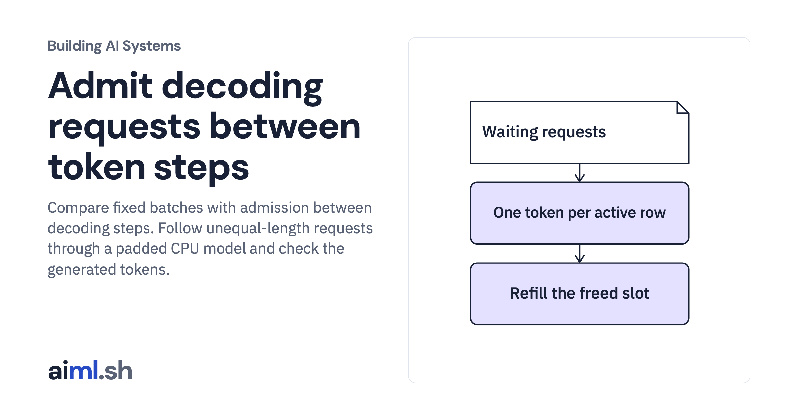

 [Building AI Systems](../) · lesson 19 of 21

# Admit decoding requests between token steps

Compare fixed batches with admission between decoding steps. Follow unequal-length requests through a padded CPU model and check the generated tokens.

- **Full lesson:** [https://aiml.sh/courses/building-ai-systems/admit-decoding-requests-between-token-steps/](https://aiml.sh/courses/building-ai-systems/admit-decoding-requests-between-token-steps/)
- **Reading time:** 30 min
- **Uses:** PyTorch 2.14.1, pinned in requirements.txt

## Lab

This lesson uses the same lab as [18-compare-packed-weight-quantization-and-output-error](../18-compare-packed-weight-quantization-and-output-error/lab/).
