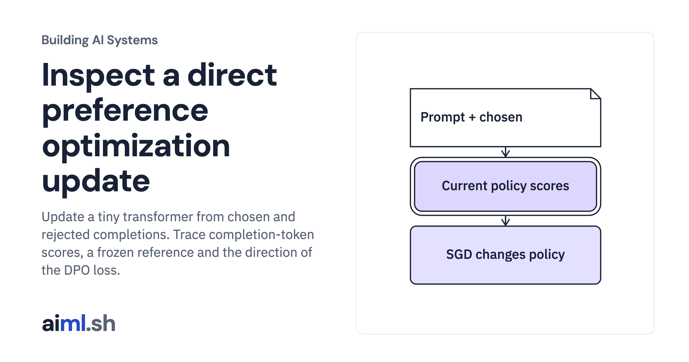

 [Building AI Systems](../) · lesson 20 of 21

# Inspect a direct preference optimization update

Update a tiny transformer from chosen and rejected completions. Trace completion-token scores, a frozen reference and the direction of the DPO loss.

- **Full lesson:** [https://aiml.sh/courses/building-ai-systems/inspect-a-direct-preference-optimization-update/](https://aiml.sh/courses/building-ai-systems/inspect-a-direct-preference-optimization-update/)
- **Reading time:** 30 min
- **Uses:** PyTorch 2.14.1, pinned in requirements.txt

## Lab

The [`lab/`](lab/) folder holds the complete runnable code, tests and recorded outputs, the same files as the lesson's download on aiml.sh. The lesson explains each step.
