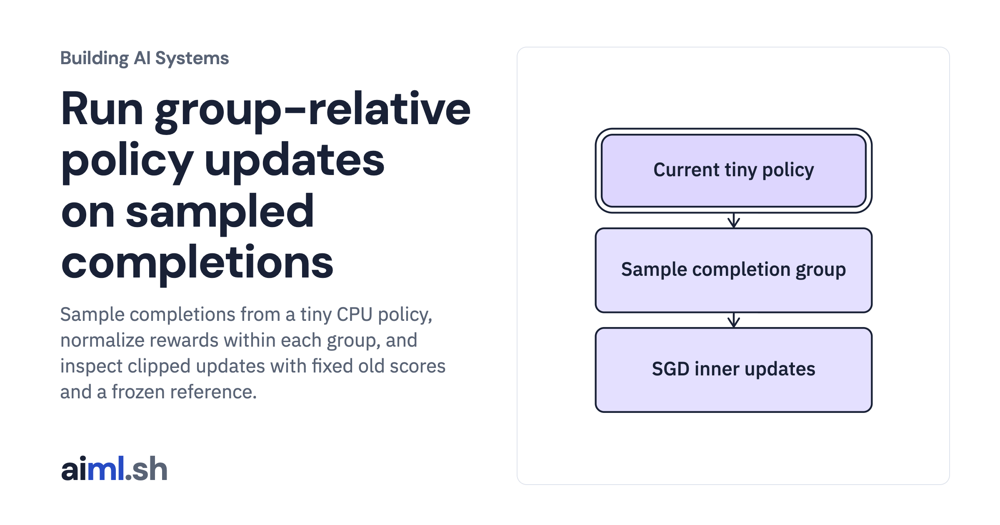

 [Building AI Systems](../) · lesson 21 of 21

# Run group-relative policy updates on sampled completions

Sample completions from a tiny CPU policy, normalize rewards within each group, and inspect clipped updates with fixed old scores and a frozen reference.

- **Full lesson:** [https://aiml.sh/courses/building-ai-systems/run-group-relative-policy-updates-on-sampled-completions/](https://aiml.sh/courses/building-ai-systems/run-group-relative-policy-updates-on-sampled-completions/)
- **Reading time:** 30 min
- **Uses:** PyTorch 2.14.1, pinned in requirements.txt

## Lab

This lesson uses the same lab as [20-inspect-a-direct-preference-optimization-update](../20-inspect-a-direct-preference-optimization-update/lab/).
