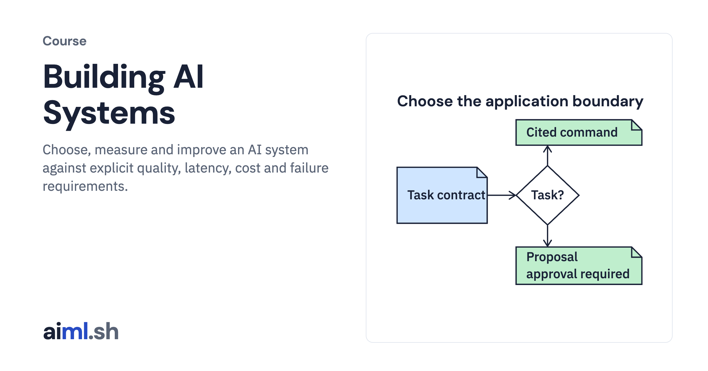

#  Building AI Systems

Choose, measure and improve an AI system against explicit quality, latency, cost and failure requirements.

- **Course on aiml.sh:** [https://aiml.sh/courses/building-ai-systems/](https://aiml.sh/courses/building-ai-systems/)
- **Lessons:** 21 · **Reading time:** about 9 hours
- **Prerequisites:** Python, basic HTTP and JSON, and AI Fundamentals. The adaptation modules add introductory linear algebra and gradients.

## What you'll learn

- Define task acceptance, resource budgets and separate response-quality checks.
- Compare model interfaces and candidates with reproducible evaluation contracts.
- Apply access boundaries, output guards, tracing and monitoring.
- Inspect inference work and low-rank updates in bounded local experiments.
- Separate preference-pair and sampled-reward objectives; inspect packed weight error and decoding admission schedules.

## Lessons

| # | Lesson | Time | Code | Full lesson |
|---|---|---|---|---|
| 1 | [Choose an architecture from task requirements](01-choose-an-ai-system-architecture/) | 25&nbsp;min | [lab](01-choose-an-ai-system-architecture/lab/) | [read](https://aiml.sh/courses/building-ai-systems/choose-an-ai-system-architecture/) |
| 2 | [Create an evaluation set and a failure taxonomy](02-create-an-evaluation-set-and-a-failure-taxonomy/) | 25&nbsp;min | [lab](02-create-an-evaluation-set-and-a-failure-taxonomy/lab/) | [read](https://aiml.sh/courses/building-ai-systems/create-an-evaluation-set-and-a-failure-taxonomy/) |
| 3 | [Set task acceptance criteria and request resource budgets](03-set-task-acceptance-criteria-and-request-resource-budgets/) | 25&nbsp;min | [lab](03-set-task-acceptance-criteria-and-request-resource-budgets/lab/) | [read](https://aiml.sh/courses/building-ai-systems/set-task-acceptance-criteria-and-request-resource-budgets/) |
| 4 | [Define a task-specific answer rubric](04-define-a-task-specific-answer-rubric/) | 30&nbsp;min | [lab](04-define-a-task-specific-answer-rubric/lab/) | [read](https://aiml.sh/courses/building-ai-systems/define-a-task-specific-answer-rubric/) |
| 5 | [Separate source support, action correctness and format validity](05-separate-source-support-action-correctness-and-format-validity/) | 25&nbsp;min | [lab](05-separate-source-support-action-correctness-and-format-validity/lab/) | [read](https://aiml.sh/courses/building-ai-systems/separate-source-support-action-correctness-and-format-validity/) |
| 6 | [Measure quality by request slice and asymmetric failure cost](06-measure-quality-by-request-slice-and-asymmetric-failure-cost/) | 25&nbsp;min | [lab](06-measure-quality-by-request-slice-and-asymmetric-failure-cost/lab/) | [read](https://aiml.sh/courses/building-ai-systems/measure-quality-by-request-slice-and-asymmetric-failure-cost/) |
| 7 | [Build a resumable repeated-trial benchmark](07-build-a-repeated-trial-benchmark/) | 22&nbsp;min | [lab](07-build-a-repeated-trial-benchmark/lab/) | [read](https://aiml.sh/courses/building-ai-systems/build-a-repeated-trial-benchmark/) |
| 8 | [Compare paired evaluation runs with uncertainty](08-build-a-paired-comparison-report/) | 22&nbsp;min | [lab](08-build-a-paired-comparison-report/lab/) | [read](https://aiml.sh/courses/building-ai-systems/build-a-paired-comparison-report/) |
| 9 | [Build a portable model adapter with contract tests](09-build-a-portable-model-adapter-with-contract-tests/) | 26&nbsp;min | [lab](09-build-a-portable-model-adapter-with-contract-tests/lab/) | [read](https://aiml.sh/courses/building-ai-systems/build-a-portable-model-adapter-with-contract-tests/) |
| 10 | [Build a model selection harness](10-build-a-model-selection-harness/) | 22&nbsp;min | [lab](10-build-a-model-selection-harness/lab/) | [read](https://aiml.sh/courses/building-ai-systems/build-a-model-selection-harness/) |
| 11 | [Check user and tool permissions across service boundaries](11-build-authentication-and-authorization-boundaries-for-users-and-tools/) | 22&nbsp;min | [lab](11-build-authentication-and-authorization-boundaries-for-users-and-tools/lab/) | [read](https://aiml.sh/courses/building-ai-systems/build-authentication-and-authorization-boundaries-for-users-and-tools/) |
| 12 | [Check tool proposals and untrusted agent handoffs](12-build-a-policy-boundary-for-untrusted-agent-handoffs-and-tool-requests/) | 22&nbsp;min | [lab](12-build-a-policy-boundary-for-untrusted-agent-handoffs-and-tool-requests/lab/) | [read](https://aiml.sh/courses/building-ai-systems/build-a-policy-boundary-for-untrusted-agent-handoffs-and-tool-requests/) |
| 13 | [Build a guardrails proxy with streaming-output tests](13-build-a-guardrails-proxy-with-streaming-output-tests/) | 20&nbsp;min | [lab](13-build-a-guardrails-proxy-with-streaming-output-tests/lab/) | [read](https://aiml.sh/courses/building-ai-systems/build-a-guardrails-proxy-with-streaming-output-tests/) |
| 14 | [Build end-to-end request tracing with source provenance](14-build-end-to-end-request-tracing-with-evidence-provenance/) | 25&nbsp;min | [lab](14-build-end-to-end-request-tracing-with-evidence-provenance/lab/) | [read](https://aiml.sh/courses/building-ai-systems/build-end-to-end-request-tracing-with-evidence-provenance/) |
| 15 | [Build LLM monitoring for latency, cost and errors](15-build-llm-monitoring-for-latency-cost-and-errors/) | 22&nbsp;min | [lab](15-build-llm-monitoring-for-latency-cost-and-errors/lab/) | [read](https://aiml.sh/courses/building-ai-systems/build-llm-monitoring-for-latency-cost-and-errors/) |
| 16 | [Compare cached and uncached attention work](16-measure-kv-cache-work/) | 25&nbsp;min | [lab](16-measure-kv-cache-work/lab/) | [read](https://aiml.sh/courses/building-ai-systems/measure-kv-cache-work/) |
| 17 | [Compare full updates and low-rank adaptation](17-compare-full-and-low-rank-updates/) | 25&nbsp;min | [lab](17-compare-full-and-low-rank-updates/lab/) | [read](https://aiml.sh/courses/building-ai-systems/compare-full-and-low-rank-updates/) |
| 18 | [Compare packed weight quantization and output error](18-compare-packed-weight-quantization-and-output-error/) | 30&nbsp;min | [lab](18-compare-packed-weight-quantization-and-output-error/lab/) | [read](https://aiml.sh/courses/building-ai-systems/compare-packed-weight-quantization-and-output-error/) |
| 19 | [Admit decoding requests between token steps](19-admit-decoding-requests-between-token-steps/) | 30&nbsp;min | [lab](18-compare-packed-weight-quantization-and-output-error/lab/) | [read](https://aiml.sh/courses/building-ai-systems/admit-decoding-requests-between-token-steps/) |
| 20 | [Inspect a direct preference optimization update](20-inspect-a-direct-preference-optimization-update/) | 30&nbsp;min | [lab](20-inspect-a-direct-preference-optimization-update/lab/) | [read](https://aiml.sh/courses/building-ai-systems/inspect-a-direct-preference-optimization-update/) |
| 21 | [Run group-relative policy updates on sampled completions](21-run-group-relative-policy-updates-on-sampled-completions/) | 30&nbsp;min | [lab](20-inspect-a-direct-preference-optimization-update/lab/) | [read](https://aiml.sh/courses/building-ai-systems/run-group-relative-policy-updates-on-sampled-completions/) |

Each lesson folder has a short summary, its diagram and its lab. The complete lesson, with explanations, recorded results and checks, is on aiml.sh.

[Back to all courses](../../README.md#courses)
