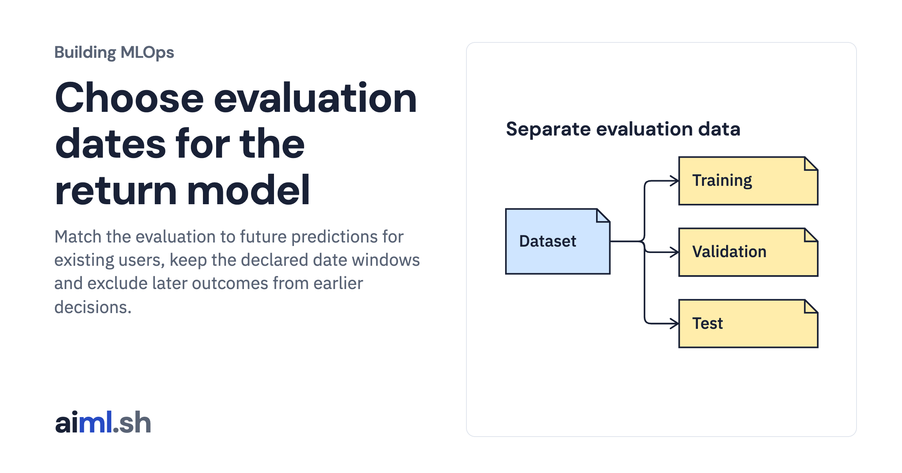

 [Building MLOps](../) · lesson 2 of 21

# Choose evaluation dates for the return model

Match the evaluation to future predictions for existing users, keep the declared date windows and exclude later outcomes from earlier decisions.

- **Full lesson:** [https://aiml.sh/courses/building-mlops/design-temporal-and-entity-aware-evaluation-splits/](https://aiml.sh/courses/building-mlops/design-temporal-and-entity-aware-evaluation-splits/)
- **Reading time:** 25 min
- **Uses:** Python standard library and SQLite

## Lab

This lesson uses the same lab as [01-record-data-availability-and-label-delay](../01-record-data-availability-and-label-delay/lab/).
