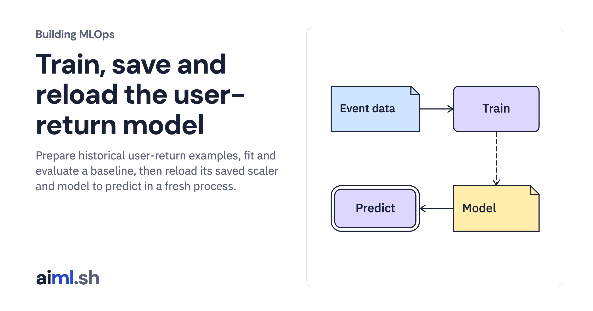

 [Building MLOps](../) · lesson 3 of 21

# Train, save and reload the user-return model

Prepare historical user-return examples, fit and evaluate a baseline, then reload its saved scaler and model to predict in a fresh process.

- **Full lesson:** [https://aiml.sh/courses/building-mlops/build-a-supervised-learning-baseline-with-reproducible-dataset-splits/](https://aiml.sh/courses/building-mlops/build-a-supervised-learning-baseline-with-reproducible-dataset-splits/)
- **Reading time:** 25 min
- **Uses:** Python standard library and SQLite

## Lab

This lesson uses the same lab as [01-record-data-availability-and-label-delay](../01-record-data-availability-and-label-delay/lab/).
