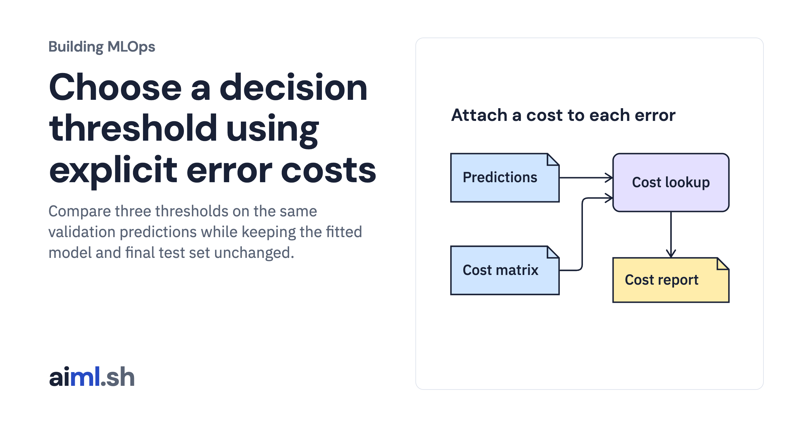

 [Building MLOps](../) · lesson 4 of 21

# Choose a decision threshold using explicit error costs

Compare three thresholds on the same validation predictions while keeping the fitted model and final test set unchanged.

- **Full lesson:** [https://aiml.sh/courses/building-mlops/connect-prediction-errors-to-product-costs/](https://aiml.sh/courses/building-mlops/connect-prediction-errors-to-product-costs/)
- **Reading time:** 25 min
- **Uses:** Python standard library and SQLite

## Lab

This lesson uses the same lab as [01-record-data-availability-and-label-delay](../01-record-data-availability-and-label-delay/lab/).
