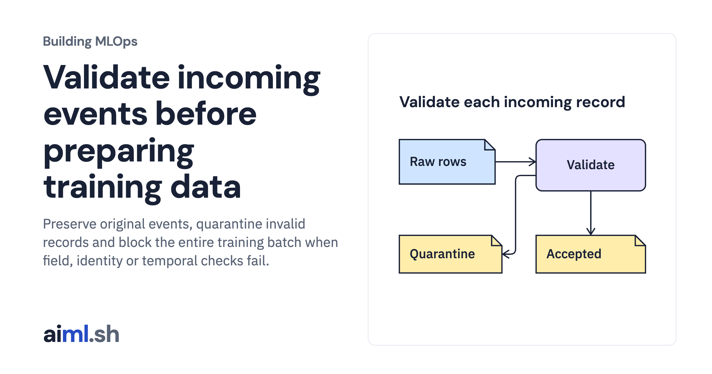

 [Building MLOps](../) · lesson 5 of 21

# Validate incoming events before preparing training data

Preserve original events, quarantine invalid records and block the entire training batch when field, identity or temporal checks fail.

- **Full lesson:** [https://aiml.sh/courses/building-mlops/validate-a-dataset-and-quarantine-invalid-records/](https://aiml.sh/courses/building-mlops/validate-a-dataset-and-quarantine-invalid-records/)
- **Reading time:** 25 min
- **Uses:** Python standard library and SQLite

## Lab

This lesson uses the same lab as [01-record-data-availability-and-label-delay](../01-record-data-availability-and-label-delay/lab/).
