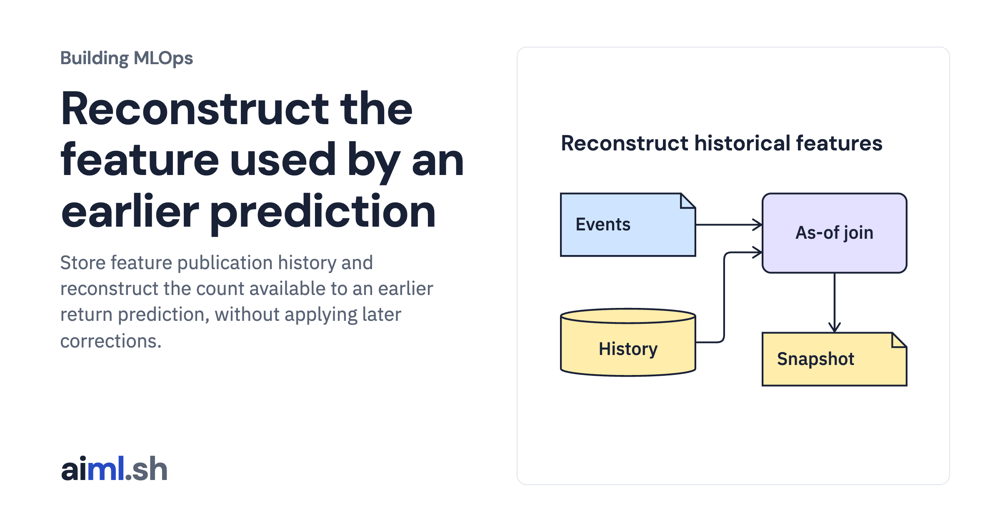

 [Building MLOps](../) · lesson 6 of 21

# Reconstruct the feature used by an earlier prediction

Store feature publication history and reconstruct the count available to an earlier return prediction, without applying later corrections.

- **Full lesson:** [https://aiml.sh/courses/building-mlops/build-point-in-time-feature-joins/](https://aiml.sh/courses/building-mlops/build-point-in-time-feature-joins/)
- **Reading time:** 25 min
- **Uses:** Python standard library and SQLite

## Lab

This lesson uses the same lab as [01-record-data-availability-and-label-delay](../01-record-data-availability-and-label-delay/lab/).
