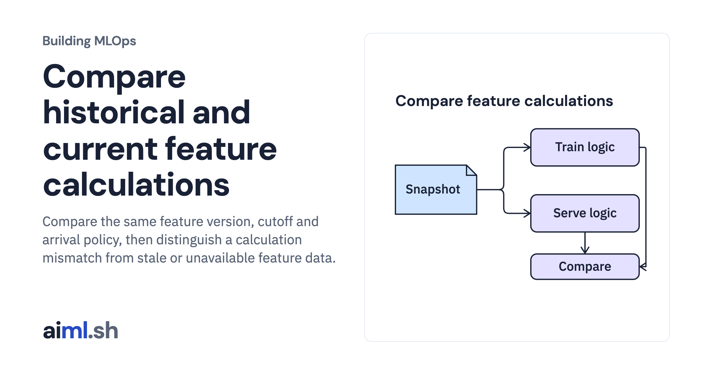

 [Building MLOps](../) · lesson 7 of 21

# Compare historical and current feature calculations

Compare the same feature version, cutoff and arrival policy, then distinguish a calculation mismatch from stale or unavailable feature data.

- **Full lesson:** [https://aiml.sh/courses/building-mlops/test-feature-freshness-and-training-serving-parity/](https://aiml.sh/courses/building-mlops/test-feature-freshness-and-training-serving-parity/)
- **Reading time:** 25 min
- **Uses:** Python standard library and SQLite

## Lab

This lesson uses the same lab as [01-record-data-availability-and-label-delay](../01-record-data-availability-and-label-delay/lab/).
