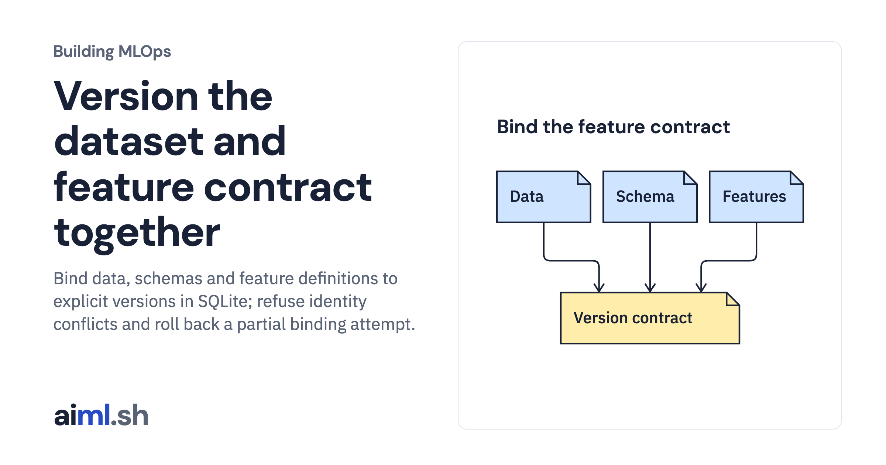

 [Building MLOps](../) · lesson 8 of 21

# Version the dataset and feature contract together

Bind data, schemas and feature definitions to explicit versions in SQLite; refuse identity conflicts and roll back a partial binding attempt.

- **Full lesson:** [https://aiml.sh/courses/building-mlops/version-data-schemas-and-feature-definitions/](https://aiml.sh/courses/building-mlops/version-data-schemas-and-feature-definitions/)
- **Reading time:** 25 min
- **Uses:** Python standard library and SQLite

## Lab

This lesson uses the same lab as [01-record-data-availability-and-label-delay](../01-record-data-availability-and-label-delay/lab/).
