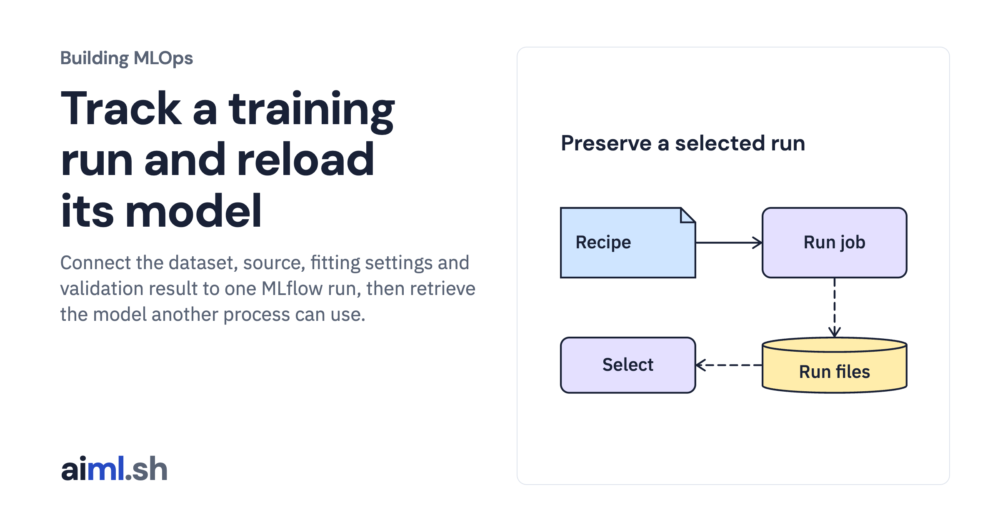

 [Building MLOps](../) · lesson 9 of 21

# Track a training run and reload its model

Connect the dataset, source, fitting settings and validation result to one MLflow run, then retrieve the model another process can use.

- **Full lesson:** [https://aiml.sh/courses/building-mlops/track-run-identity-and-select-an-immutable-training-artifact/](https://aiml.sh/courses/building-mlops/track-run-identity-and-select-an-immutable-training-artifact/)
- **Reading time:** 30 min
- **Uses:** Pinned MLflow, Prefect and FastAPI dependencies in requirements-platform.txt

## Lab

This lesson uses the same lab as [01-record-data-availability-and-label-delay](../01-record-data-availability-and-label-delay/lab/).
