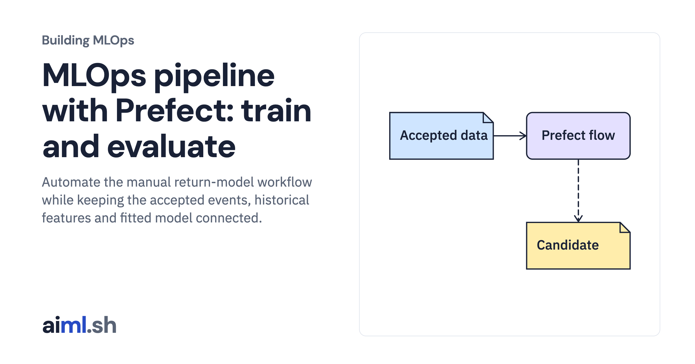

 [Building MLOps](../) · lesson 10 of 21

# Connect preparation, training and evaluation with Prefect

Automate the manual return-model workflow while keeping the accepted events, historical features and fitted model connected.

- **Full lesson:** [https://aiml.sh/courses/building-mlops/automate-the-user-return-workflow-with-prefect/](https://aiml.sh/courses/building-mlops/automate-the-user-return-workflow-with-prefect/)
- **Reading time:** 30 min
- **Uses:** Pinned MLflow, Prefect and FastAPI dependencies in requirements-platform.txt

## Lab

This lesson uses the same lab as [01-record-data-availability-and-label-delay](../01-record-data-availability-and-label-delay/lab/).
