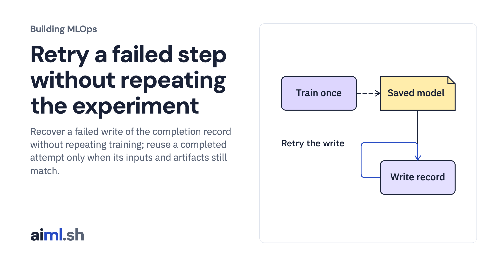

 [Building MLOps](../) · lesson 11 of 21

# Retry a failed step without repeating the experiment

Recover a failed write of the completion record without repeating training; reuse a completed attempt only when its inputs and artifacts still match.

- **Full lesson:** [https://aiml.sh/courses/building-mlops/retry-a-failed-pipeline-step-without-repeating-training/](https://aiml.sh/courses/building-mlops/retry-a-failed-pipeline-step-without-repeating-training/)
- **Reading time:** 30 min
- **Uses:** Pinned MLflow, Prefect and FastAPI dependencies in requirements-platform.txt

## Lab

This lesson uses the same lab as [01-record-data-availability-and-label-delay](../01-record-data-availability-and-label-delay/lab/).
