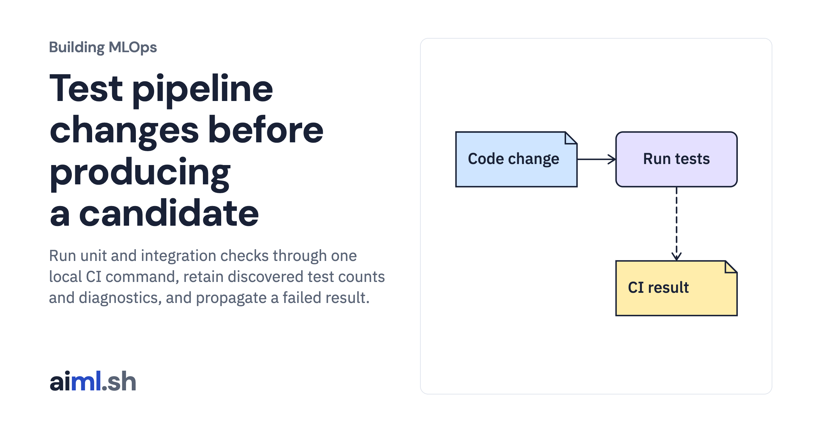

 [Building MLOps](../) · lesson 12 of 21

# Test pipeline changes before producing a candidate

Run unit and integration checks through one local CI command, retain discovered test counts and diagnostics, and propagate a failed result.

- **Full lesson:** [https://aiml.sh/courses/building-mlops/test-data-and-model-pipeline-changes-in-ci/](https://aiml.sh/courses/building-mlops/test-data-and-model-pipeline-changes-in-ci/)
- **Reading time:** 30 min
- **Uses:** Pinned MLflow, Prefect and FastAPI dependencies in requirements-platform.txt

## Lab

This lesson uses the same lab as [01-record-data-availability-and-label-delay](../01-record-data-availability-and-label-delay/lab/).
