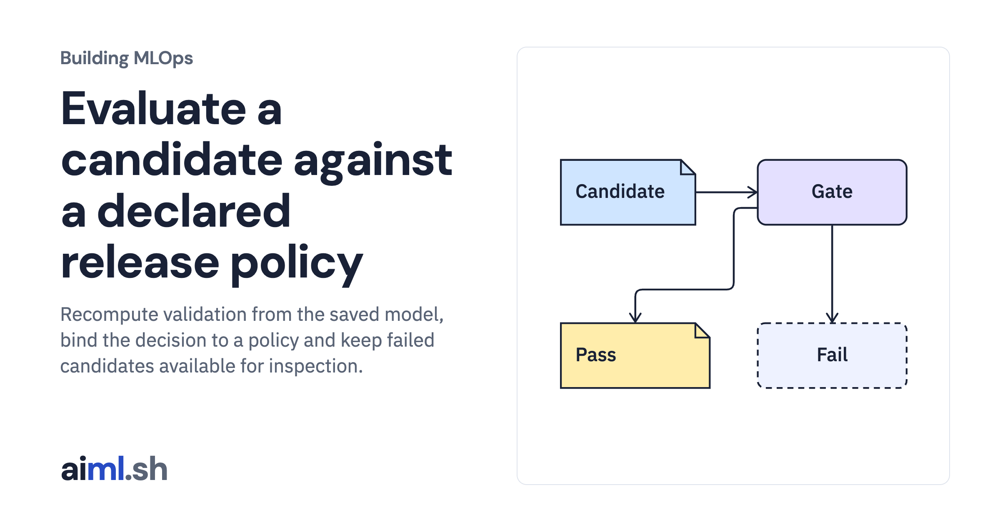

 [Building MLOps](../) · lesson 13 of 21

# Evaluate a candidate against a declared release policy

Recompute validation from the saved model, bind the decision to a policy and keep failed candidates available for inspection.

- **Full lesson:** [https://aiml.sh/courses/building-mlops/gate-a-model-candidate-on-validation-results/](https://aiml.sh/courses/building-mlops/gate-a-model-candidate-on-validation-results/)
- **Reading time:** 30 min
- **Uses:** Pinned MLflow, Prefect and FastAPI dependencies in requirements-platform.txt

## Lab

This lesson uses the same lab as [01-record-data-availability-and-label-delay](../01-record-data-availability-and-label-delay/lab/).
