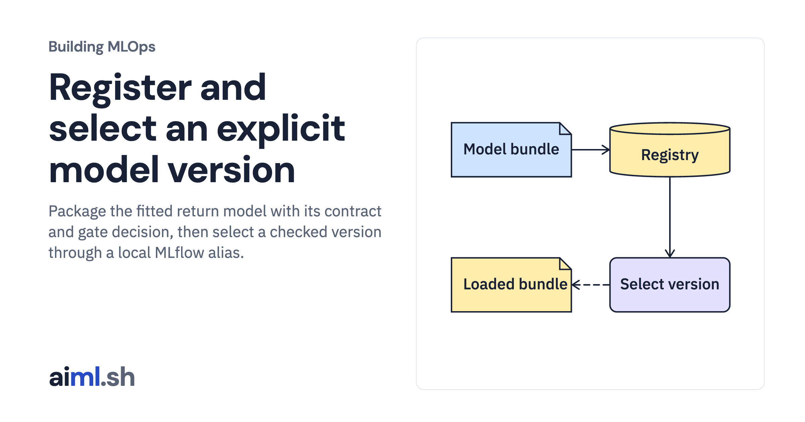

 [Building MLOps](../) · lesson 14 of 21

# Register and select an explicit model version

Package the fitted return model with its contract and gate decision, then select a checked version through a local MLflow alias.

- **Full lesson:** [https://aiml.sh/courses/building-mlops/register-and-select-a-content-addressed-model/](https://aiml.sh/courses/building-mlops/register-and-select-a-content-addressed-model/)
- **Reading time:** 30 min
- **Uses:** Pinned MLflow, Prefect and FastAPI dependencies in requirements-platform.txt

## Lab

This lesson uses the same lab as [01-record-data-availability-and-label-delay](../01-record-data-availability-and-label-delay/lab/).
