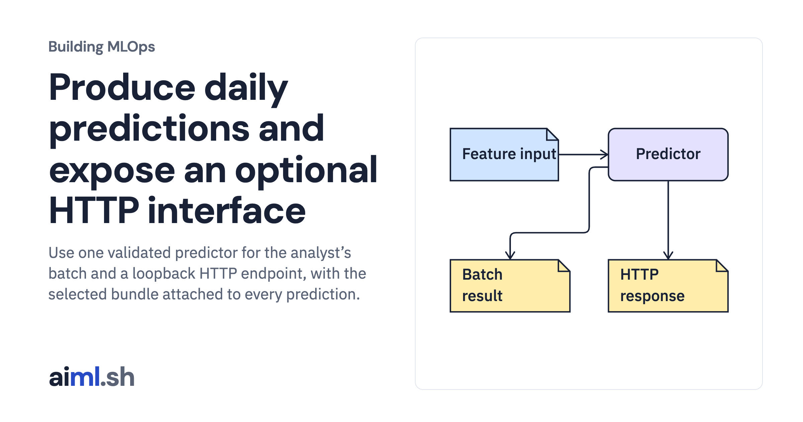

 [Building MLOps](../) · lesson 15 of 21

# Produce daily predictions and expose an optional HTTP interface

Use one validated predictor for the analyst’s batch and a loopback HTTP endpoint, with the selected bundle attached to every prediction.

- **Full lesson:** [https://aiml.sh/courses/building-mlops/serve-a-versioned-predictor-through-batch-and-http/](https://aiml.sh/courses/building-mlops/serve-a-versioned-predictor-through-batch-and-http/)
- **Reading time:** 30 min
- **Uses:** Pinned MLflow, Prefect and FastAPI dependencies in requirements-platform.txt

## Lab

This lesson uses the same lab as [01-record-data-availability-and-label-delay](../01-record-data-availability-and-label-delay/lab/).
