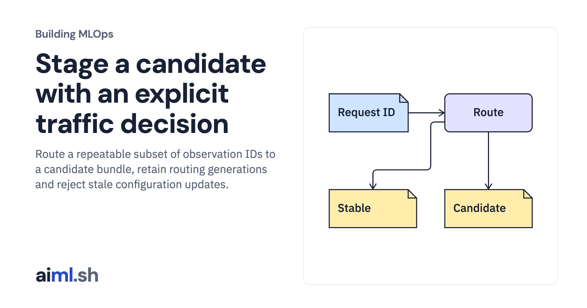

 [Building MLOps](../) · lesson 16 of 21

# Stage a candidate with an explicit traffic decision

Route a repeatable subset of observation IDs to a candidate bundle, retain routing generations and reject stale configuration updates.

- **Full lesson:** [https://aiml.sh/courses/building-mlops/route-a-sticky-canary-and-compare-cohort-outcomes/](https://aiml.sh/courses/building-mlops/route-a-sticky-canary-and-compare-cohort-outcomes/)
- **Reading time:** 30 min
- **Uses:** Pinned MLflow, Prefect and FastAPI dependencies in requirements-platform.txt

## Lab

This lesson uses the same lab as [01-record-data-availability-and-label-delay](../01-record-data-availability-and-label-delay/lab/).
