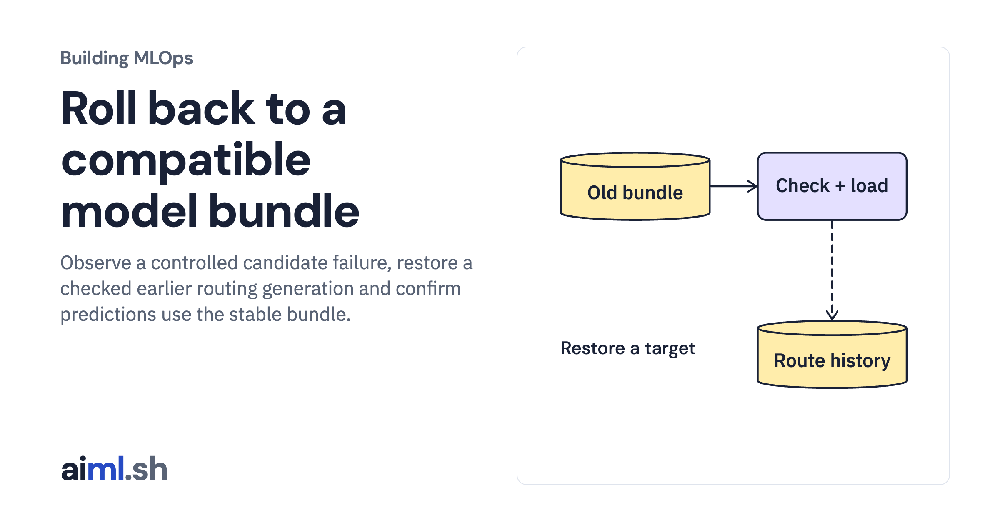

 [Building MLOps](../) · lesson 17 of 21

# Roll back to a compatible model bundle

Observe a controlled candidate failure, restore a checked earlier routing generation and confirm predictions use the stable bundle.

- **Full lesson:** [https://aiml.sh/courses/building-mlops/roll-back-a-model-with-feature-contract-checks/](https://aiml.sh/courses/building-mlops/roll-back-a-model-with-feature-contract-checks/)
- **Reading time:** 30 min
- **Uses:** Pinned MLflow, Prefect and FastAPI dependencies in requirements-platform.txt

## Lab

This lesson uses the same lab as [01-record-data-availability-and-label-delay](../01-record-data-availability-and-label-delay/lab/).
