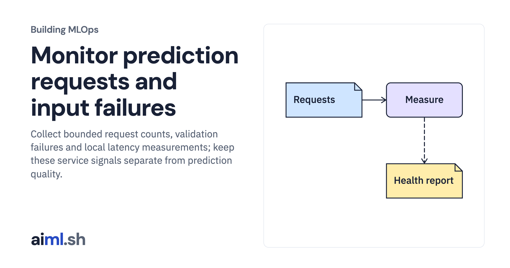

 [Building MLOps](../) · lesson 18 of 21

# Monitor prediction requests and input failures

Collect bounded request counts, validation failures and local latency measurements; keep these service signals separate from prediction quality.

- **Full lesson:** [https://aiml.sh/courses/building-mlops/distinguish-schema-freshness-and-distribution-signals/](https://aiml.sh/courses/building-mlops/distinguish-schema-freshness-and-distribution-signals/)
- **Reading time:** 30 min
- **Uses:** Pinned MLflow, Prefect and FastAPI dependencies in requirements-platform.txt

## Lab

This lesson uses the same lab as [01-record-data-availability-and-label-delay](../01-record-data-availability-and-label-delay/lab/).
