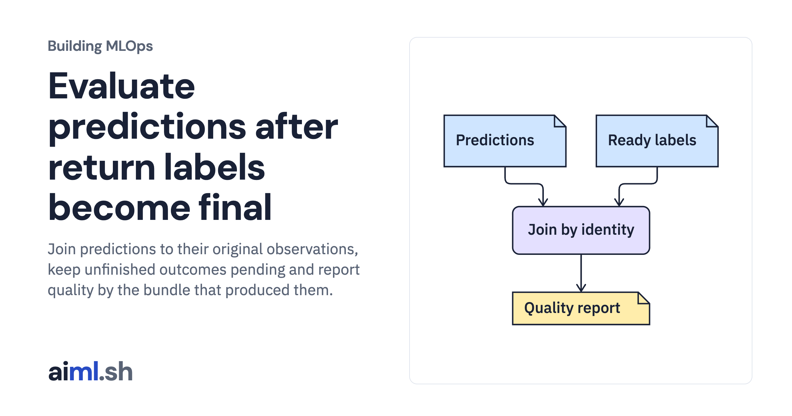

 [Building MLOps](../) · lesson 19 of 21

# Evaluate predictions after return labels become final

Join predictions to their original observations, keep unfinished outcomes pending and report quality by the bundle that produced them.

- **Full lesson:** [https://aiml.sh/courses/building-mlops/join-delayed-outcomes-and-review-retraining/](https://aiml.sh/courses/building-mlops/join-delayed-outcomes-and-review-retraining/)
- **Reading time:** 30 min
- **Uses:** Pinned MLflow, Prefect and FastAPI dependencies in requirements-platform.txt

## Lab

This lesson uses the same lab as [01-record-data-availability-and-label-delay](../01-record-data-availability-and-label-delay/lab/).
