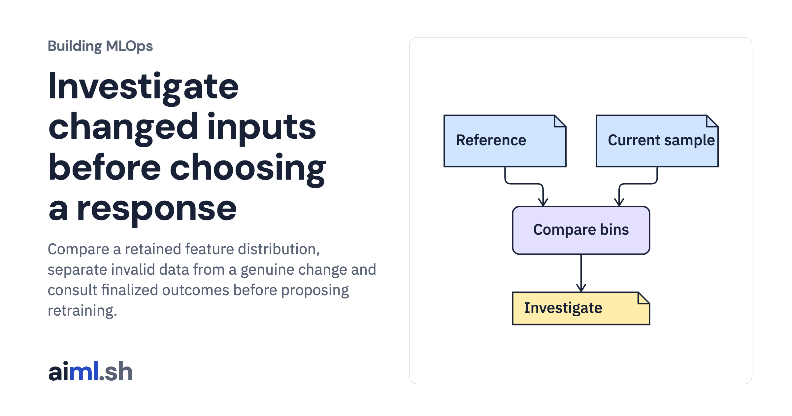

 [Building MLOps](../) · lesson 20 of 21

# Investigate changed inputs before choosing a response

Compare a retained feature distribution, separate invalid data from a genuine change and consult finalized outcomes before proposing retraining.

- **Full lesson:** [https://aiml.sh/courses/building-mlops/investigate-feature-drift-before-retraining/](https://aiml.sh/courses/building-mlops/investigate-feature-drift-before-retraining/)
- **Reading time:** 30 min
- **Uses:** Pinned MLflow, Prefect and FastAPI dependencies in requirements-platform.txt

## Lab

This lesson uses the same lab as [01-record-data-availability-and-label-delay](../01-record-data-availability-and-label-delay/lab/).
