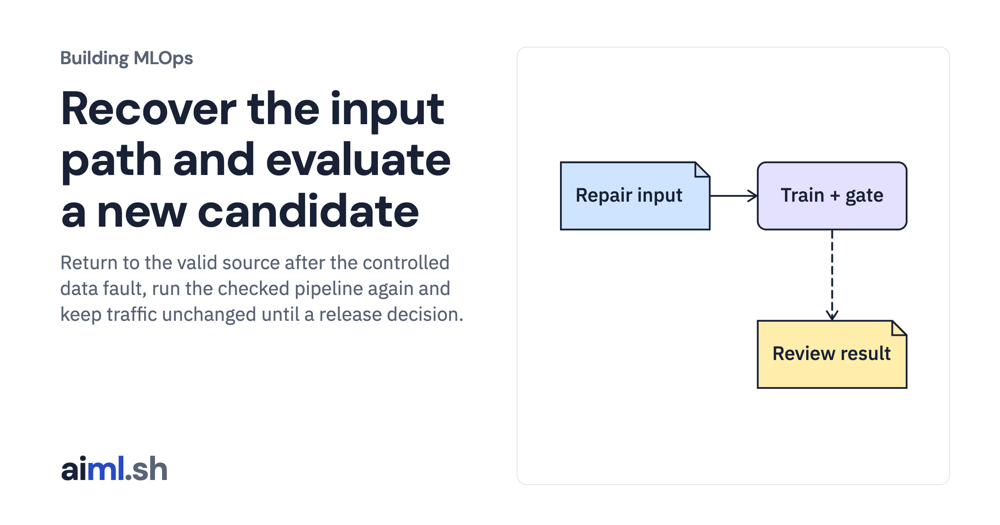

 [Building MLOps](../) · lesson 21 of 21

# Recover the input path and evaluate a new candidate

Return to the valid source after the controlled data fault, run the checked pipeline again and keep traffic unchanged until a release decision.

- **Full lesson:** [https://aiml.sh/courses/building-mlops/recover-the-user-return-pipeline-without-automatic-promotion/](https://aiml.sh/courses/building-mlops/recover-the-user-return-pipeline-without-automatic-promotion/)
- **Reading time:** 30 min
- **Uses:** Pinned MLflow, Prefect and FastAPI dependencies in requirements-platform.txt

## Lab

This lesson uses the same lab as [01-record-data-availability-and-label-delay](../01-record-data-availability-and-label-delay/lab/).
