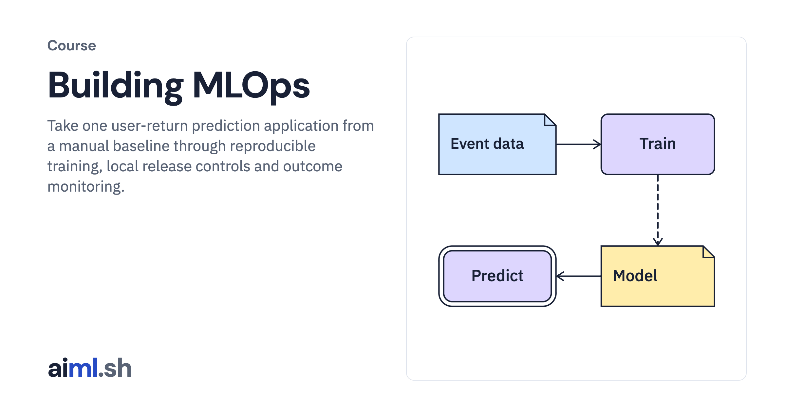

#  Building MLOps

Take one user-return prediction application from a manual baseline through reproducible training, local release controls and outcome monitoring.

- **Course on aiml.sh:** [https://aiml.sh/courses/building-mlops/](https://aiml.sh/courses/building-mlops/)
- **Lessons:** 21 · **Reading time:** about 10 hours
- **Prerequisites:** Python, SQL, basic supervised learning and familiarity with training and validation datasets.

## What you'll learn

- Define prediction time, data availability and delayed labels; train and reload a baseline under explicit evaluation rules.
- Version historical features and datasets, then track real local training with MLflow.
- Automate the same workflow with Prefect, test failure recovery and gate candidates.
- Register, serve, stage and roll back compatible model bundles locally.
- Monitor request failures, delayed outcomes and input drift before choosing a response.

## Lessons

| # | Lesson | Time | Code | Full lesson |
|---|---|---|---|---|
| 1 | [Use only data available when the prediction is made](01-record-data-availability-and-label-delay/) | 25&nbsp;min | [lab](01-record-data-availability-and-label-delay/lab/) | [read](https://aiml.sh/courses/building-mlops/record-data-availability-and-label-delay/) |
| 2 | [Choose evaluation dates for the return model](02-design-temporal-and-entity-aware-evaluation-splits/) | 25&nbsp;min | [lab](01-record-data-availability-and-label-delay/lab/) | [read](https://aiml.sh/courses/building-mlops/design-temporal-and-entity-aware-evaluation-splits/) |
| 3 | [Train, save and reload the user-return model](03-build-a-supervised-learning-baseline-with-reproducible-dataset-splits/) | 25&nbsp;min | [lab](01-record-data-availability-and-label-delay/lab/) | [read](https://aiml.sh/courses/building-mlops/build-a-supervised-learning-baseline-with-reproducible-dataset-splits/) |
| 4 | [Choose a decision threshold using explicit error costs](04-connect-prediction-errors-to-product-costs/) | 25&nbsp;min | [lab](01-record-data-availability-and-label-delay/lab/) | [read](https://aiml.sh/courses/building-mlops/connect-prediction-errors-to-product-costs/) |
| 5 | [Validate incoming events before preparing training data](05-validate-a-dataset-and-quarantine-invalid-records/) | 25&nbsp;min | [lab](01-record-data-availability-and-label-delay/lab/) | [read](https://aiml.sh/courses/building-mlops/validate-a-dataset-and-quarantine-invalid-records/) |
| 6 | [Reconstruct the feature used by an earlier prediction](06-build-point-in-time-feature-joins/) | 25&nbsp;min | [lab](01-record-data-availability-and-label-delay/lab/) | [read](https://aiml.sh/courses/building-mlops/build-point-in-time-feature-joins/) |
| 7 | [Compare historical and current feature calculations](07-test-feature-freshness-and-training-serving-parity/) | 25&nbsp;min | [lab](01-record-data-availability-and-label-delay/lab/) | [read](https://aiml.sh/courses/building-mlops/test-feature-freshness-and-training-serving-parity/) |
| 8 | [Version the dataset and feature contract together](08-version-data-schemas-and-feature-definitions/) | 25&nbsp;min | [lab](01-record-data-availability-and-label-delay/lab/) | [read](https://aiml.sh/courses/building-mlops/version-data-schemas-and-feature-definitions/) |
| 9 | [Track a training run and reload its model](09-track-run-identity-and-select-an-immutable-training-artifact/) | 30&nbsp;min | [lab](01-record-data-availability-and-label-delay/lab/) | [read](https://aiml.sh/courses/building-mlops/track-run-identity-and-select-an-immutable-training-artifact/) |
| 10 | [Connect preparation, training and evaluation with Prefect](10-automate-the-user-return-workflow-with-prefect/) | 30&nbsp;min | [lab](01-record-data-availability-and-label-delay/lab/) | [read](https://aiml.sh/courses/building-mlops/automate-the-user-return-workflow-with-prefect/) |
| 11 | [Retry a failed step without repeating the experiment](11-retry-a-failed-pipeline-step-without-repeating-training/) | 30&nbsp;min | [lab](01-record-data-availability-and-label-delay/lab/) | [read](https://aiml.sh/courses/building-mlops/retry-a-failed-pipeline-step-without-repeating-training/) |
| 12 | [Test pipeline changes before producing a candidate](12-test-data-and-model-pipeline-changes-in-ci/) | 30&nbsp;min | [lab](01-record-data-availability-and-label-delay/lab/) | [read](https://aiml.sh/courses/building-mlops/test-data-and-model-pipeline-changes-in-ci/) |
| 13 | [Evaluate a candidate against a declared release policy](13-gate-a-model-candidate-on-validation-results/) | 30&nbsp;min | [lab](01-record-data-availability-and-label-delay/lab/) | [read](https://aiml.sh/courses/building-mlops/gate-a-model-candidate-on-validation-results/) |
| 14 | [Register and select an explicit model version](14-register-and-select-a-content-addressed-model/) | 30&nbsp;min | [lab](01-record-data-availability-and-label-delay/lab/) | [read](https://aiml.sh/courses/building-mlops/register-and-select-a-content-addressed-model/) |
| 15 | [Produce daily predictions and expose an optional HTTP interface](15-serve-a-versioned-predictor-through-batch-and-http/) | 30&nbsp;min | [lab](01-record-data-availability-and-label-delay/lab/) | [read](https://aiml.sh/courses/building-mlops/serve-a-versioned-predictor-through-batch-and-http/) |
| 16 | [Stage a candidate with an explicit traffic decision](16-route-a-sticky-canary-and-compare-cohort-outcomes/) | 30&nbsp;min | [lab](01-record-data-availability-and-label-delay/lab/) | [read](https://aiml.sh/courses/building-mlops/route-a-sticky-canary-and-compare-cohort-outcomes/) |
| 17 | [Roll back to a compatible model bundle](17-roll-back-a-model-with-feature-contract-checks/) | 30&nbsp;min | [lab](01-record-data-availability-and-label-delay/lab/) | [read](https://aiml.sh/courses/building-mlops/roll-back-a-model-with-feature-contract-checks/) |
| 18 | [Monitor prediction requests and input failures](18-distinguish-schema-freshness-and-distribution-signals/) | 30&nbsp;min | [lab](01-record-data-availability-and-label-delay/lab/) | [read](https://aiml.sh/courses/building-mlops/distinguish-schema-freshness-and-distribution-signals/) |
| 19 | [Evaluate predictions after return labels become final](19-join-delayed-outcomes-and-review-retraining/) | 30&nbsp;min | [lab](01-record-data-availability-and-label-delay/lab/) | [read](https://aiml.sh/courses/building-mlops/join-delayed-outcomes-and-review-retraining/) |
| 20 | [Investigate changed inputs before choosing a response](20-investigate-feature-drift-before-retraining/) | 30&nbsp;min | [lab](01-record-data-availability-and-label-delay/lab/) | [read](https://aiml.sh/courses/building-mlops/investigate-feature-drift-before-retraining/) |
| 21 | [Recover the input path and evaluate a new candidate](21-recover-the-user-return-pipeline-without-automatic-promotion/) | 30&nbsp;min | [lab](01-record-data-availability-and-label-delay/lab/) | [read](https://aiml.sh/courses/building-mlops/recover-the-user-return-pipeline-without-automatic-promotion/) |

Each lesson folder has a short summary, its diagram and its lab. The complete lesson, with explanations, recorded results and checks, is on aiml.sh.

[Back to all courses](../../README.md#courses)
