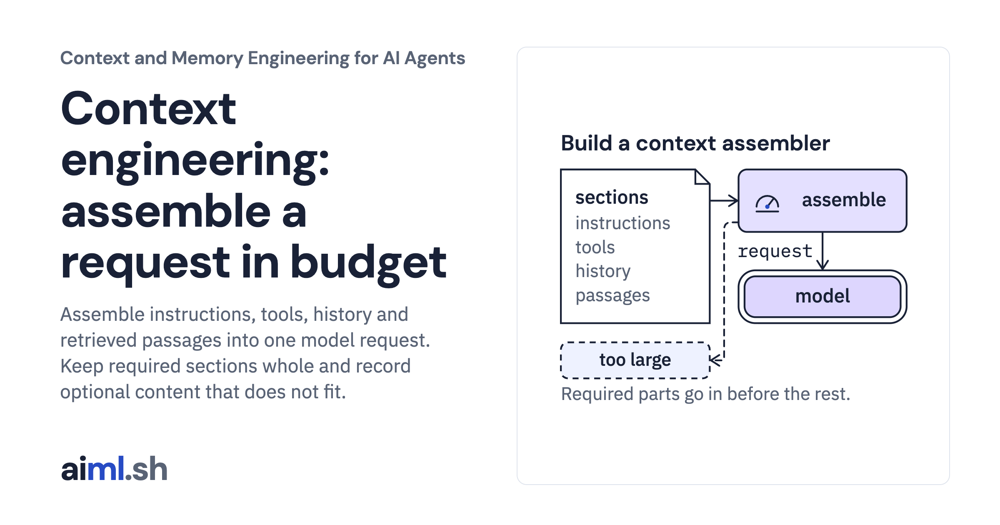

 [Context and Memory Engineering for AI Agents](../) · lesson 1 of 10

# Assemble a model request within a context budget

[](https://aiml.sh/courses/context-and-memory/build-a-context-assembler/)

Assemble instructions, tools, history and retrieved passages into one model request. Keep required sections whole and record optional content that does not fit.

- **Full lesson:** [https://aiml.sh/courses/context-and-memory/build-a-context-assembler/](https://aiml.sh/courses/context-and-memory/build-a-context-assembler/)
- **Reading time:** 30 min
- **Uses:** transformers 5.20.1 for the pinned Gemma 4 E2B tokenizer files (no model weights); local gemma4:e2b via Ollama only to record new answers

## Lab

The [`lab/`](lab/) folder holds the complete runnable code, tests and recorded outputs, the same files as the lesson's download on aiml.sh. The lesson explains each step.

### Lab notes

#### Context assembler

Python 3.11 or later. Token counts come from the pinned Gemma 4 E2B tokenizer and chat template, the same files and hashes as the context budget build; `prepare.py` downloads the tokenizer files once, with no account and no model weights. The tests call no model: they grade recorded answers. Recording new answers needs a local Ollama server with `gemma4:e2b`.

##### Run

```sh
python -m pip install -r requirements.txt
python prepare.py                         # once: the pinned tokenizer files
python demo.py                            # assembles request.json, recorded in assembly-result.json
python answer_check.py                    # grades the recorded answers, recorded in answer-grades.json
python -m unittest -v test_assembler.py test_answer_check.py
```

To record new answers: `ollama pull gemma4:e2b`, then `python answer_check.py record`.

##### What it does

`assemble(request, count)` builds one chat request from six sections: instructions, tool definitions, history, the current question, the tool calls and results of the current turn, and retrieved evidence passages.

- Instructions, tool definitions, the current question and every tool call with its result are required. If they do not fit, `RequiredContextTooLarge` is raised. A tool call is never sent without its result.
- `fill_order` decides which optional section is filled first. The default is `["history", "evidence"]`.
- History keeps complete user/assistant turns, newest first, and stops at the first turn that does not fit. This is the policy from the context budget build.
- Evidence keeps passages by score, highest first, ties by ID. A passage that does not fit is skipped, and a smaller passage may still fit.
- Evidence goes into the user message inside `<evidence>` blocks. Passage text is escaped, so it cannot close its block. Evidence never enters the system message.
- The result has a `trace` with one entry per section item: kept or dropped, the tokens it needs, and the reason.

`naive_truncate` is the baseline: it concatenates sections in arrival order and drops the oldest messages until the request fits. `audit` checks any assembled request for instructions in the system message, assistant replies without their user message, and tool calls without results.

`answer_check.py` sends the default assembly, the evidence-first assembly and the baseline to `gemma4:e2b`, pinned by digest in `answer-model.json`, five seeds each, and grades each answer pass, fail or incomplete. Fifteen answers from a small model illustrate how these requests behave; they are not a measure of answer quality.

##### Limits

The counter is pinned to Gemma 4 E2B. For another model, count with its tokenizer and chat template, and compare with the prompt count your server reports; Ollama's count differed from the pinned template by 2 tokens here.

Delimiting evidence does not stop a model from following or repeating instructions written inside a passage. Tool results go unchanged into `tool` messages; role separation is the only protection applied to them. The assembler does not detect prompt injection, check permissions or validate argument types beyond required and known keys. The answer grader uses string rules, not a judgment of meaning.

##### Files

- `contracts.py`: request contract and validation.
- `assembler.py`: assembly policy, naive baseline and structural audit.
- `tokenizer.py`, `tokenizer-manifest.json`, `prepare.py`, `requirements.txt`, `requirements.lock`: the pinned tokenizer.
- `request.json`, `demo.py`, `assembly-result.json`: fixture and recorded output.
- `answer_model.py`, `answer-model.json`, `answer_check.py`, `answer-result.json`, `answer-grades.json`: the pinned answer model, recorded answers and grades.
- `test_assembler.py`, `test_answer_check.py`: tests.
