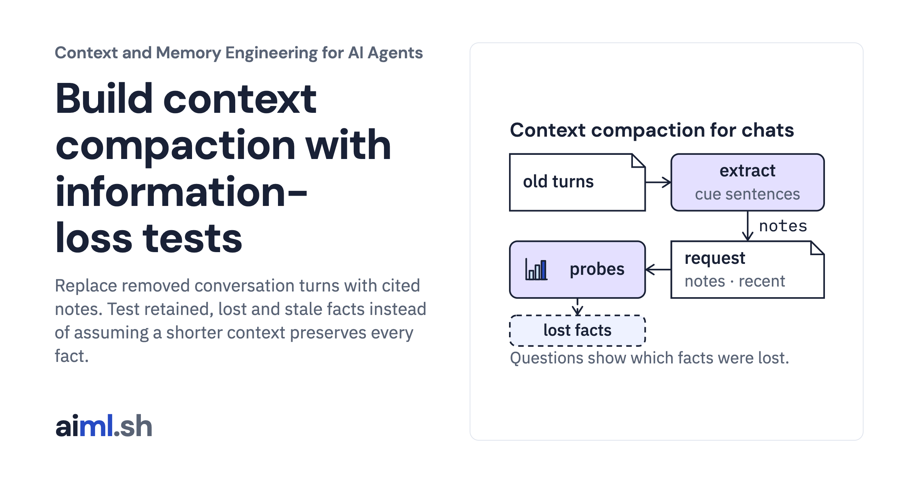

 [Context and Memory Engineering for AI Agents](../) · lesson 2 of 10

# Build context compaction with information-loss tests

[](https://aiml.sh/courses/context-and-memory/build-context-compaction/)

Replace removed conversation turns with cited notes. Test retained, lost and stale facts instead of assuming a shorter context preserves every fact.

- **Full lesson:** [https://aiml.sh/courses/context-and-memory/build-context-compaction/](https://aiml.sh/courses/context-and-memory/build-context-compaction/)
- **Reading time:** 28 min
- **Uses:** transformers 5.20.1 for the pinned Gemma 4 E2B tokenizer files (no model weights); local gemma4:e2b via Ollama only to record new answers

## Lab

The [`lab/`](lab/) folder holds the complete runnable code, tests and recorded outputs, the same files as the lesson's download on aiml.sh. The lesson explains each step.

### Lab notes

#### Context compaction with information-loss probes

Python 3.11 or later. Token counts come from the pinned Gemma 4 E2B tokenizer and chat template, the same files and hashes as the context budget build; `prepare.py` downloads the tokenizer files once, with no account and no model weights. The tests call no model: they grade recorded answers. Recording new answers needs a local Ollama server with `gemma4:e2b`.

##### Run

```sh
python -m pip install -r requirements.txt
python prepare.py                          # once: the pinned tokenizer files
python demo.py
python answer_check.py                     # grades the recorded answers
python -m unittest -v test_compactor.py test_answer_check.py
```

To record new answers: `ollama pull gemma4:e2b`, then `python answer_check.py record`.

`demo.py` compacts `request.json`, runs the drop-oldest baseline and checks every fact in `probes.json`. Its output is recorded in `compaction-result.json`; the first test checks that a fresh run still matches it.

##### What it does

`compact(request, count, extractor)`:

1. Counts the instructions and current question. If they do not fit, it raises `RequiredContextTooLarge`.
2. Keeps recent complete turns, newest first, inside the input budget minus `notes_reserve`.
3. Calls the extractor on the removed turns. The default `extract_notes` keeps each whole sentence that contains a cue word (`must`, `chose`, `will use`, `deadline` and others in `CUES`) and records its turn and role.
4. Adds notes, newest first, into all remaining space. Notes that do not fit are returned in `dropped_notes`.
5. Places the notes in the current user message inside a `<notes>` block. Note text is escaped. Notes never enter the system message.

`probe_report(messages, probes)` checks each named fact by exact text match, raw or escaped:

- `preserved`: the fact is in the final messages.
- `lost`: the fact is not in the final messages.
- `stale`: a fact marked `superseded_by` is still in the final messages.
- `absent`: a superseded fact is not in the final messages.

`drop_oldest` is the baseline from the context budget build: recent complete turns and no notes.

`answer_check.py` sends the compacted request and the drop-oldest request to `gemma4:e2b`, pinned by digest in `answer-model.json`, five seeds each, and grades whether each answer names the decisions that still apply without presenting the replaced one as current. Ten answers from a small model illustrate how the requests behave; they are not a measure of answer quality.

##### Limits

The extractor is a keyword rule. It loses facts written without a cue word, and it keeps a superseded decision next to the decision that replaced it. The probes show both. A model-written summary would plug in through the same `extractor` argument, but it is not included or tested here. Run the same probes on any summarizer you add.

Exact text matching is strict. A summary that paraphrases a fact counts as `lost`. For paraphrasing summarizers you need a different check, and you need to review it.

The counter is pinned to Gemma 4 E2B; for another model, count with its tokenizer and chat template. The answer grader uses string rules, not a judgment of meaning.

##### Files

- `compactor.py`: contract, compaction policy, extractor, baseline and probe report.
- `tokenizer.py`, `tokenizer-manifest.json`, `prepare.py`, `requirements.txt`, `requirements.lock`: the pinned tokenizer.
- `answer_model.py`, `answer-model.json`, `answer_check.py`, `answer-result.json`, `answer-grades.json`: the pinned answer model, recorded answers and grades.
- `request.json`, `probes.json`, `demo.py`, `compaction-result.json`: fixture, probes and recorded output.
- `test_compactor.py`, `test_answer_check.py`: tests.
