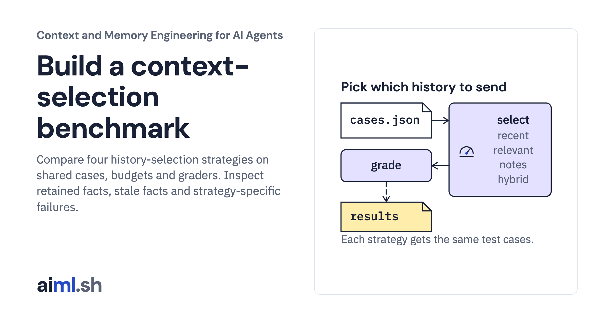

 [Context and Memory Engineering for AI Agents](../) · lesson 4 of 10

# Build a context-selection benchmark

[](https://aiml.sh/courses/context-and-memory/build-a-context-selection-benchmark/)

Compare four history-selection strategies on shared cases, budgets and graders. Inspect retained facts, stale facts and strategy-specific failures.

- **Full lesson:** [https://aiml.sh/courses/context-and-memory/build-a-context-selection-benchmark/](https://aiml.sh/courses/context-and-memory/build-a-context-selection-benchmark/)
- **Reading time:** 27 min
- **Uses:** transformers 5.20.1 for the pinned Gemma 4 E2B tokenizer files (no model weights); local gemma4:e2b via Ollama only to record new answers

## Lab

The [`lab/`](lab/) folder holds the complete runnable code, tests and recorded outputs, the same files as the lesson's download on aiml.sh. The lesson explains each step.

### Lab notes

#### Compare context-selection strategies

Python 3.11 or later. Token counts come from the pinned Gemma 4 E2B tokenizer and chat template, the same files and hashes as the context budget build; `prepare.py` downloads the tokenizer files once, with no account and no model weights. The tests call no model: they grade recorded answers. Recording new answers needs a local Ollama server with `gemma4:e2b`.

##### Run

```sh
python -m pip install -r requirements.txt
python prepare.py                           # once: the pinned tokenizer files
python evaluate.py
python answer_check.py                      # grades the recorded answers
python -m unittest -v test_evaluate.py test_answer_check.py
```

To record new answers: `ollama pull gemma4:e2b`, then `python answer_check.py record`.

`evaluate.py` runs four strategies on the 12 cases in `cases.json` and prints a report. The report is recorded in `evaluation-result.json`; the first test checks that a fresh run still matches it.

##### The strategies

All four select history for one request under the same budget and the same counter (`strategies.py`).

- `recent`: newest complete turns; stop at the first that does not fit. This is the policy of the context budget build.
- `relevant`: turns that share words with the question, most shared words first; skip turns that do not fit.
- `notes`: recent turns inside the budget minus 64 tokens, plus cue-word notes from removed turns, rendered in the same escaped `<notes>` block. This is the policy of the context compaction build.
- `hybrid`: the newest turn first, then relevant turns.

##### The case set

Each case has an ID, a split (`dev` or `held_out`), a kind, a conversation, a question, a budget, the `required` facts the request must contain, and `stale` facts that a later turn replaced. `load_cases` rejects a fact that does not occur in the history, so a typo cannot make a case impossible.

The author reports writing the six `dev` cases first, using them while writing the strategies, and writing the six `held_out` cases afterwards, knowing the strategies. One commit adds both splits, so the history cannot confirm that order. The split is not blind: the cue `limit` matches two held-out cases and neither the dev cases nor the compaction build's fixture, and `test_held_out_notes_depend_on_the_limit_cue` shows that one held-out fact, in `held-pronoun`, depends on it. The report records the SHA-256 of `cases.json`, `strategies.py` and `tokenizer-manifest.json`, and the Python version.

##### What the grader measures

The grader checks, by exact text match (raw or escaped), whether each required fact and each stale fact reaches the selected messages. It measures what a model would be able to see; a paraphrased fact counts as missing.

`answer_check.py` sends each strategy's request for the six held-out cases to `gemma4:e2b`, pinned by digest in `answer-model.json`, five seeds each, and grades the answers against `answer-keys.json`, which was written from the cases' facts before any answer was recorded. 120 answers from a small model illustrate how the strategies behave; they are not a ranking.

The selection run is deterministic, so one trial is enough and no timing is recorded. The counter is pinned to Gemma 4 E2B; for another model, use its tokenizer and rerun the set.

Twelve synthetic cases are enough to show how each strategy fails. They are not enough to rank strategies for a real application. Build a case set from your own conversations, keep a held-out split, and report failed cases, not only totals.

##### Files

- `strategies.py`: the four strategies.
- `evaluate.py`: case loader, grader and report.
- `tokenizer.py`, `tokenizer-manifest.json`, `prepare.py`, `requirements.txt`, `requirements.lock`: the pinned tokenizer.
- `answer_model.py`, `answer-model.json`, `answer_check.py`, `answer-keys.json`, `answer-result.json`, `answer-grades.json`: the pinned answer model, keys, recorded answers and grades.
- `cases.json`, `evaluation-result.json`: case set and recorded report.
- `test_evaluate.py`, `test_answer_check.py`: tests.
