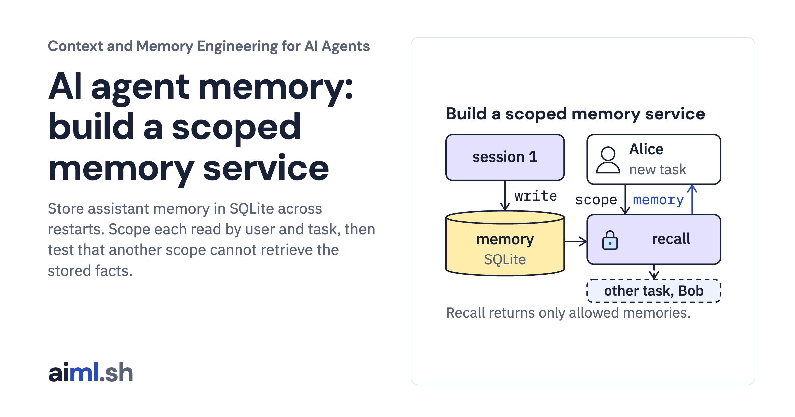

 [Context and Memory Engineering for AI Agents](../) · lesson 5 of 10

# Build a memory service with explicit user and task scope

[](https://aiml.sh/courses/context-and-memory/build-a-memory-service/)

Store assistant memory in SQLite across restarts. Scope each read by user and task, then test that another scope cannot retrieve the stored facts.

- **Full lesson:** [https://aiml.sh/courses/context-and-memory/build-a-memory-service/](https://aiml.sh/courses/context-and-memory/build-a-memory-service/)
- **Reading time:** 26 min
- **Uses:** Standard library only

## Lab

The [`lab/`](lab/) folder holds the complete runnable code, tests and recorded outputs, the same files as the lesson's download on aiml.sh. The lesson explains each step.

### Lab notes

#### Memory service with explicit user and task scope

Python 3.11 or later. Standard library only: `sqlite3` stores the memories in one file. No model, server, API key or network access.

##### Run

```sh
python demo.py
python -m unittest -v test_memory.py
```

`demo.py` writes five memories for two users into a temporary SQLite file, closes it, opens it again as a new store, and runs four recall queries. Its output is recorded in `memory-result.json`; the first test checks that a fresh run still matches it.

##### What it does

`MemoryStore(path)` opens or creates a SQLite database. A new file gets the `memories` table and `PRAGMA user_version = 1`. A nonempty version-0 file or an unsupported version number is refused with `SchemaError`. A version-1 stamp is trusted; the constructor does not validate all table and column definitions.

- `remember(scope, level, text, source)` stores one memory. `level` is `user` (visible in every task of that user) or `task` (visible only in that task). Every memory needs a source, such as the conversation turn it came from.
- `recall(scope, query, limit)` returns up to `limit` visible memories that share words with the query, most shared words first, newer first on a tie.
- Every read goes through one query: `WHERE user_id = ? AND (task_id IS NULL OR task_id = ?)`. Values are always bound as parameters, never formatted into SQL.

A `Scope` is `(user, task)`. Build it only after your application has authenticated the user.

##### Limits

Recall counts shared words. It does not match `like` and `likes`, synonyms or paraphrases. This build has no correction, expiry or deletion; a memory stays until the file is deleted. One store holds one SQLite connection; it is not a multi-process service. The clock is injected so the demo is deterministic.

##### Files

- `memory.py`: schema, scope and store.
- `scenario.json`, `demo.py`, `memory-result.json`: fixture and recorded output.
- `test_memory.py`: failure tests.
