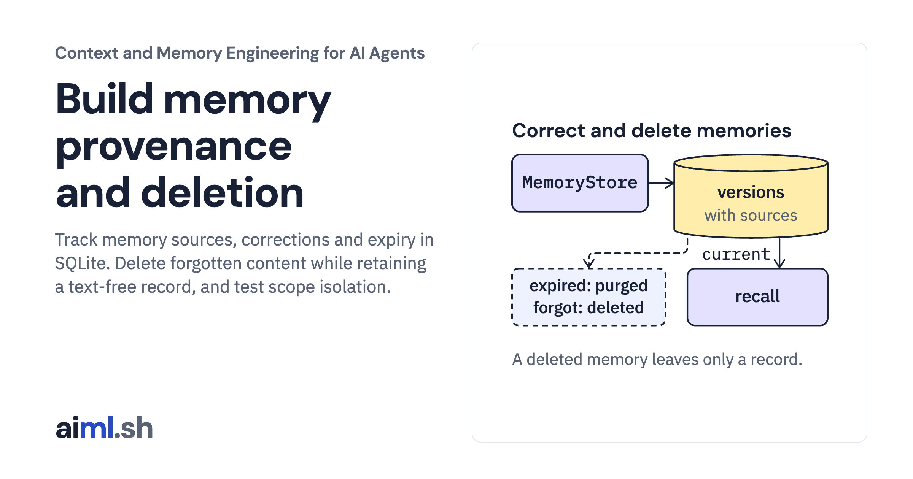

 [Context and Memory Engineering for AI Agents](../) · lesson 6 of 10

# Build memory provenance and deletion

[](https://aiml.sh/courses/context-and-memory/build-memory-provenance-and-deletion/)

Track memory sources, corrections and expiry in SQLite. Delete forgotten content while retaining a text-free record, and test scope isolation.

- **Full lesson:** [https://aiml.sh/courses/context-and-memory/build-memory-provenance-and-deletion/](https://aiml.sh/courses/context-and-memory/build-memory-provenance-and-deletion/)
- **Reading time:** 30 min
- **Uses:** Standard library only

## Lab

The [`lab/`](lab/) folder holds the complete runnable code, tests and recorded outputs, the same files as the lesson's download on aiml.sh. The lesson explains each step.

### Lab notes

#### Memory provenance, corrections, expiry and deletion

Python 3.11 or later. Standard library only: `sqlite3`. No model, server, API key or network access.

##### Run

```sh
python demo.py
python -m unittest -v test_memory.py
```

`demo.py` replays `scenario.json` for one user over eight simulated days: it stores three memories, corrects one, lets one expire, purges it, and forgets one at the user's request. It runs the scenario twice, with `secure_delete` on and off, and checks whether the forgotten text is still in the database file. The output is recorded in `memory-result.json`; the first test checks that a fresh run still matches it.

##### What it does

This is version 2 of the store from the memory service build. Opening a version 1 file migrates it in one transaction; if the migration fails, the file stays at version 1.

- `remember(scope, level, text, source, ttl_days)` stores a memory with a source and an optional expiry.
- `correct(scope, memory_id, text, source, ttl_days)` stores a new memory that supersedes the newest version. The old version stays as history.
- `history(scope, memory_id)` returns every version, oldest first, with sources.
- `recall(scope, query, limit)` returns only current memories: not superseded and not expired.
- `forget(scope, memory_id, reason)` deletes every version and records the deleted IDs and reason, without the text.
- `purge_expired()` deletes every version of each memory whose newest version has expired, for every user.

Another user's memory and a missing memory raise the same `MemoryNotFound` message.

The store sets `PRAGMA secure_delete = ON`, so SQLite overwrites deleted rows with zeros. With it off, the demo finds the forgotten passport number still in the file.

##### Limits

Deletion here covers the database file. It does not reach backups, copies in logs, caches, search indexes or messages already sent to a model provider. SQLite's documentation notes that FTS virtual tables can keep traces even with `secure_delete` on; this store has none. The clock is injected so the demo is deterministic; in production, run `purge_expired` on a schedule.

##### Files

- `memory.py`: schema version 2, migration, store.
- `scenario.json`, `demo.py`, `memory-result.json`: fixture and recorded output.
- `test_memory.py`: failure tests.
