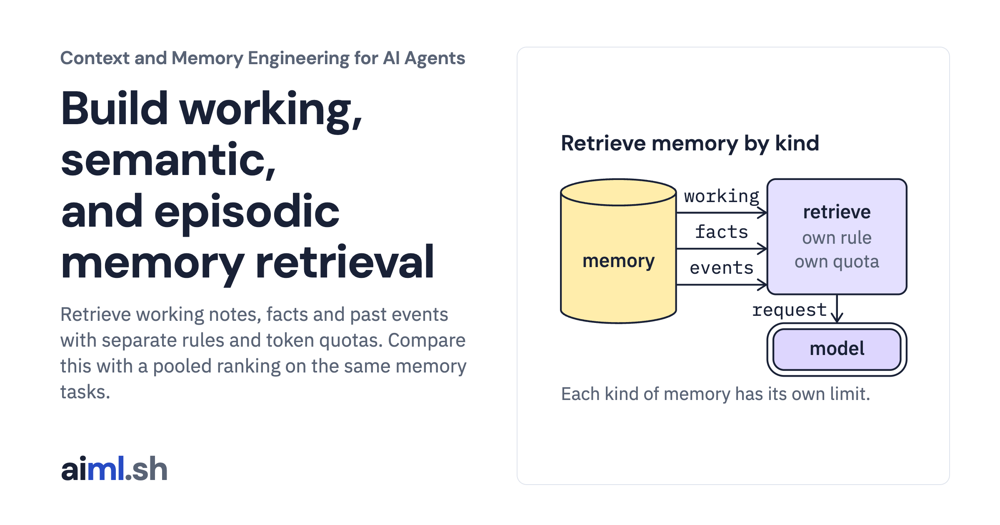

 [Context and Memory Engineering for AI Agents](../) · lesson 7 of 10

# Build working, semantic, and episodic memory retrieval

[](https://aiml.sh/courses/context-and-memory/build-memory-retrieval/)

Retrieve working notes, facts and past events with separate rules and token quotas. Compare this with a pooled ranking on the same memory tasks.

- **Full lesson:** [https://aiml.sh/courses/context-and-memory/build-memory-retrieval/](https://aiml.sh/courses/context-and-memory/build-memory-retrieval/)
- **Reading time:** 28 min
- **Uses:** transformers 5.20.1 for the pinned Gemma 4 E2B tokenizer files (no model weights); local gemma4:e2b via Ollama only to record new answers

## Lab

The [`lab/`](lab/) folder holds the complete runnable code, tests and recorded outputs, the same files as the lesson's download on aiml.sh. The lesson explains each step.

### Lab notes

#### Working, semantic and episodic memory retrieval

Python 3.11 or later, with `sqlite3`. Token counts come from the pinned Gemma 4 E2B tokenizer; `prepare.py` downloads its files once, with no account and no model weights. No embeddings. The tests call no model: they grade recorded answers. Recording new answers needs a local Ollama server with `gemma4:e2b`.

##### Run

```sh
python -m pip install -r requirements.txt
python prepare.py                          # once: the pinned tokenizer files
python demo.py
python answer_check.py                     # grades the recorded answers
python -m unittest -v test_retrieval.py test_answer_check.py
```

To record new answers: `ollama pull gemma4:e2b`, then `python answer_check.py record`. `answer_check.py` sends both questions with the per-kind block and with the pooled baseline, five seeds each, and grades the answers against keys written from the scenario's facts.

`demo.py` stores one user's memories in a temporary SQLite file: three facts (one later corrected), three past episodes and three working notes for the current task. It retrieves them for two questions, once per kind and once with a single pooled ranking, and checks which required facts reach the result. The output is recorded in `retrieval-result.json`; the first test checks that a fresh run still matches it.

##### What it does

`memory.py` is version 3 of the store from the provenance build. Each memory has a `kind`:

- `working`: the current task's state, such as dates or a budget. Task level only.
- `semantic`: facts about the user, such as preferences.
- `episodic`: past events, with the date they happened in `occurred_at`.

Opening a version 1 or 2 file migrates it in one transaction; existing memories become `semantic`.

`retrieve(store, scope, query, quotas)` builds one block with a section per kind. Each kind has its own rule and selected-line token quota (`QUOTAS`). The code adds independently counted line costs; headers, section tags and the chat template are excluded. Count the completed request separately before sending it:

- Working: newest first, at most `WORKING_LIMIT` items, no relevance filter. Stop at the first item that does not fit.
- Semantic: more shared words first, newer fact on a tie. Skip a fact that does not fit.
- Episodic: more shared words first, more recent event on a tie. Skip an episode that does not fit.

Only current memories are retrieved: corrected and expired ones are excluded by the store. Memory text is escaped inside each section. The result records each section's kept and dropped IDs and token use.

`pooled` is the baseline: one ranking over every kind by shared words.

##### Limits

Relevance is shared words, so paraphrases and synonyms do not match. Working memory is always included, even when it is unrelated to the question. Token counts come from the pinned Gemma 4 E2B tokenizer, the same files and hashes as the context budget build. The quotas are settings for this fixture, not tuned values.

##### Files

- `memory.py`: schema version 3 and store.
- `retrieval.py`: per-kind retrieval and pooled baseline.
- `tokenizer.py`, `tokenizer-manifest.json`, `prepare.py`, `requirements.txt`, `requirements.lock`: the pinned tokenizer.
- `answer_model.py`, `answer-model.json`, `answer_check.py`, `answer-result.json`, `answer-grades.json`: the pinned answer model, recorded answers and grades.
- `scenario.json`, `demo.py`, `retrieval-result.json`: fixture and recorded output.
- `test_retrieval.py`: failure tests.
