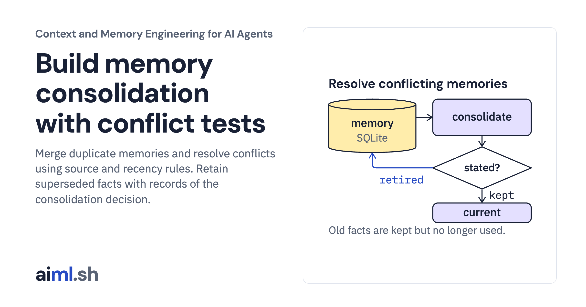

 [Context and Memory Engineering for AI Agents](../) · lesson 8 of 10

# Build memory consolidation with conflict tests

[](https://aiml.sh/courses/context-and-memory/build-memory-consolidation-with-conflict-tests/)

Merge duplicate memories and resolve conflicts using source and recency rules. Retain superseded facts with records of the consolidation decision.

- **Full lesson:** [https://aiml.sh/courses/context-and-memory/build-memory-consolidation-with-conflict-tests/](https://aiml.sh/courses/context-and-memory/build-memory-consolidation-with-conflict-tests/)
- **Reading time:** 28 min
- **Uses:** Standard library only

## Lab

The [`lab/`](lab/) folder holds the complete runnable code, tests and recorded outputs, the same files as the lesson's download on aiml.sh. The lesson explains each step.

### Lab notes

#### Memory consolidation and conflict resolution

Python 3.11 or later. Standard library only: `sqlite3`. No model, API key or network access.

##### Run

```sh
python demo.py
python -m unittest -v test_consolidation.py
```

`demo.py` stores nine facts about one user across four tasks, including a conflict between a stated and an inferred fact, a changed preference, a duplicate, a free-text contradiction and a task-only override. It runs `consolidate` twice and shows the current facts in two tasks before and after. The output is recorded in `consolidation-result.json`; the first test checks that a fresh run still matches it.

##### What it does

`memory.py` is version 4 of the store from the retrieval build. A semantic memory may name an `attribute` (such as `diet`) and has an `authority`: `user` for something the user said, `inferred` for something a model or rule concluded. A `resolutions` table records which memory was kept, which was retired and by which rule. Retired memories stay stored and are no longer current.

`consolidate(store, scope)` compares current facts at the same level and task:

1. `duplicate`: same attribute (or no attribute) and the same normalized text. Keep the older memory, which has the first source.
2. `user statement over inference`: same attribute, one stated and one inferred. Keep the stated one, whatever their order.
3. `newer statement`: same attribute and authority. Keep the newer.

All decisions are written in one transaction. A second run finds nothing new.

A task-level fact about an attribute overrides user-level facts about that attribute inside its task only. Consolidation does not retire either.

Forgetting or purging a kept memory also deletes the memories it retired, so they cannot become current again.

##### Limits

Conflicts are found only between facts that name the same attribute. Two facts without an attribute that contradict each other in different words, such as "Alice dislikes noisy hotels." and "Alice does not mind noise in hotels.", are both kept; the report lists every fact without an attribute. Assigning attributes is the writer's job and is not tested here. The rules are a policy for this build, not a general truth: some applications should ask the user instead of choosing.

##### Files

- `memory.py`: schema version 4 and store.
- `consolidate.py`: rules, plan and consolidation.
- `scenario.json`, `demo.py`, `consolidation-result.json`: fixture and recorded output.
- `test_consolidation.py`: failure tests.
