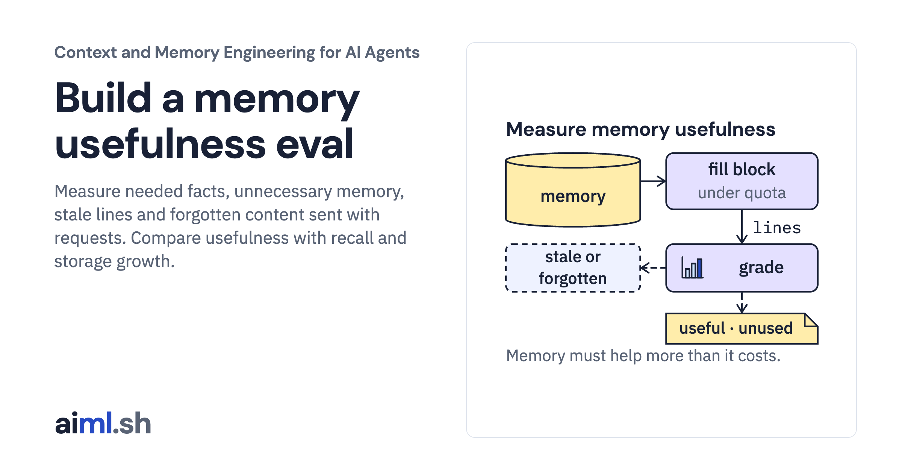

 [Context and Memory Engineering for AI Agents](../) · lesson 10 of 10

# Build a memory usefulness eval

[](https://aiml.sh/courses/context-and-memory/build-a-memory-usefulness-eval/)

Measure needed facts, unnecessary memory, stale lines and forgotten content sent with requests. Compare usefulness with recall and storage growth.

- **Full lesson:** [https://aiml.sh/courses/context-and-memory/build-a-memory-usefulness-eval/](https://aiml.sh/courses/context-and-memory/build-a-memory-usefulness-eval/)
- **Reading time:** 26 min
- **Uses:** transformers 5.20.1 for the pinned Gemma 4 E2B tokenizer files (no model weights); local gemma4:e2b via Ollama only to record new answers

## Lab

The [`lab/`](lab/) folder holds the complete runnable code, tests and recorded outputs, the same files as the lesson's download on aiml.sh. The lesson explains each step.

### Lab notes

#### Evaluate memory usefulness, stale facts and storage growth

Python 3.11 or later. Token counts come from the pinned Gemma 4 E2B tokenizer, the same files and hashes as the context budget build; `prepare.py` downloads the tokenizer files once, with no account and no model weights. The tests call no model: they grade recorded answers. Recording new answers needs a local Ollama server with `gemma4:e2b`.

##### Run

```sh
python -m pip install -r requirements.txt
python prepare.py                  # once: the pinned tokenizer files
python generate_cases.py
python evaluate.py                 # recorded in evaluation-result.json
python answer_check.py             # grades the recorded answers, recorded in answer-grades.json
python -m unittest -v test_evaluate.py test_answer_check.py
```

To record new answers: `ollama pull gemma4:e2b`, then `python answer_check.py record`.

`generate_cases.py` writes `cases.json`: three users' memory events with ten focused questions, and a 200-turn replay for a fourth user. `evaluate.py` fills a managed store and an append-only store from the events, fills the memory block for each question three ways, and grades each block. It also samples storage every 20 turns of the replay. The output is recorded in `evaluation-result.json`; the first test checks that a fresh run still matches it, apart from the environment block.

##### What it measures

For each question, selection adds separately counted line costs within the facts quota. Headers, delimiters and the chat template are not included; count the complete request separately before sending it.

- **Recall**: required facts found in the block, out of required facts.
- **Usefulness**: lines that contain a required fact, out of lines sent.
- **Stale lines**: lines that contain a replaced fact.
- **Forgotten lines**: lines that contain a fact the user asked to forget.
- **Memory tokens**: sum of the separately counted selected-line costs, using the pinned Gemma 4 E2B tokenizer.

The three strategies are `managed-all` (every current fact), `managed-relevant` (current facts that share a word with the question) and `append-all` (every stored fact, never corrected or deleted).

Storage is counted in rows: stored, current, superseded (kept as history) and deletion records. File sizes depend on the SQLite version and page size, so they are reported in the environment block and not compared.

`answer_check.py` sends every question with each strategy's block to `gemma4:e2b`, pinned by digest in `answer-model.json`, five seeds each, and grades each answer pass, fail or incomplete. 150 answers from a small model illustrate how the blocks behave; they are not a measure of answer quality.

##### Original answer-key limitation

The desk-approval key expects Priya because Bob says she is his manager. No note grants her approval authority. All 15 saved desk answers say the approver is unknown; the original grader marks them failed. `answer_check.py` and `answer-grades.json` retain that original grading for reproduction, not as a valid model-quality comparison. The required-fact labels for that question share the same unsupported assumption. Do not infer an approval policy from a manager relationship.

##### Limits

The stores are filled from labels, which act as perfect extraction. Usefulness counts a line as useful only if it contains a listed fact by exact text; the answer check grades answers with string rules, not a judgment of meaning. Ten questions show the trade-off between recall and usefulness; they are not enough to choose a strategy for a real application. All of them are development cases, written together with the strategies and graders; no held-out evaluation was run.

##### Files

- `generate_cases.py`, `cases.json`: fixture and its generator.
- `evaluate.py`: strategies, grader, storage sampling.
- `memory.py`: the version 4 store from the consolidation build.
- `tokenizer.py`, `tokenizer-manifest.json`, `prepare.py`, `requirements.txt`, `requirements.lock`: the pinned tokenizer.
- `evaluation-result.json`: recorded output.
- `answer_model.py`, `answer-model.json`, `answer_check.py`, `answer-result.json`, `answer-grades.json`: the pinned answer model, recorded answers and grades.
- `test_evaluate.py`, `test_answer_check.py`: tests.
