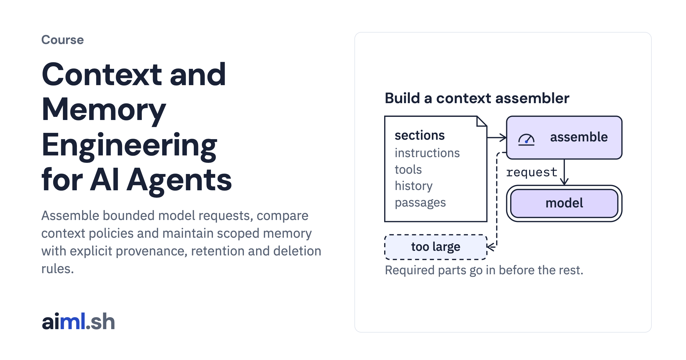

#  Context and Memory Engineering for AI Agents

Assemble bounded model requests, compare context policies and maintain scoped memory with explicit provenance, retention and deletion rules.

- **Course on aiml.sh:** [https://aiml.sh/courses/context-and-memory/](https://aiml.sh/courses/context-and-memory/)
- **Lessons:** 10 · **Reading time:** about 5 hours
- **Prerequisites:** Python, JSON, the AI Fundamentals context-window lesson and the context budget manager (Trim history to a token budget in the LangGraph course). Token-counting labs require the pinned tokenizer and dependencies named in their READMEs; offline replay does not require model weights.

## What you'll learn

- Assemble, compact, isolate and compare model context.
- Store and retrieve memory with explicit user and task scope.
- Consolidate conflicts, retain provenance and propagate deletion.
- Evaluate retained facts and memory usefulness separately from token savings.

## Lessons

| # | Lesson | Time | Code | Full lesson |
|---|---|---|---|---|
| 1 | [Assemble a model request within a context budget](01-build-a-context-assembler/) | 30&nbsp;min | [lab](01-build-a-context-assembler/lab/) | [read](https://aiml.sh/courses/context-and-memory/build-a-context-assembler/) |
| 2 | [Build context compaction with information-loss tests](02-build-context-compaction/) | 28&nbsp;min | [lab](02-build-context-compaction/lab/) | [read](https://aiml.sh/courses/context-and-memory/build-context-compaction/) |
| 3 | [Build isolated contexts for users, tasks, and agents](03-build-isolated-contexts/) | 26&nbsp;min | [lab](03-build-isolated-contexts/lab/) | [read](https://aiml.sh/courses/context-and-memory/build-isolated-contexts/) |
| 4 | [Build a context-selection benchmark](04-build-a-context-selection-benchmark/) | 27&nbsp;min | [lab](04-build-a-context-selection-benchmark/lab/) | [read](https://aiml.sh/courses/context-and-memory/build-a-context-selection-benchmark/) |
| 5 | [Build a memory service with explicit user and task scope](05-build-a-memory-service/) | 26&nbsp;min | [lab](05-build-a-memory-service/lab/) | [read](https://aiml.sh/courses/context-and-memory/build-a-memory-service/) |
| 6 | [Build memory provenance and deletion](06-build-memory-provenance-and-deletion/) | 30&nbsp;min | [lab](06-build-memory-provenance-and-deletion/lab/) | [read](https://aiml.sh/courses/context-and-memory/build-memory-provenance-and-deletion/) |
| 7 | [Build working, semantic, and episodic memory retrieval](07-build-memory-retrieval/) | 28&nbsp;min | [lab](07-build-memory-retrieval/lab/) | [read](https://aiml.sh/courses/context-and-memory/build-memory-retrieval/) |
| 8 | [Build memory consolidation with conflict tests](08-build-memory-consolidation-with-conflict-tests/) | 28&nbsp;min | [lab](08-build-memory-consolidation-with-conflict-tests/lab/) | [read](https://aiml.sh/courses/context-and-memory/build-memory-consolidation-with-conflict-tests/) |
| 9 | [Compare memory compaction with fact-retention checks](09-build-a-memory-compaction-benchmark/) | 30&nbsp;min | [lab](09-build-a-memory-compaction-benchmark/lab/) | [read](https://aiml.sh/courses/context-and-memory/build-a-memory-compaction-benchmark/) |
| 10 | [Build a memory usefulness eval](10-build-a-memory-usefulness-eval/) | 26&nbsp;min | [lab](10-build-a-memory-usefulness-eval/lab/) | [read](https://aiml.sh/courses/context-and-memory/build-a-memory-usefulness-eval/) |

Each lesson folder has a short summary, its diagram and its lab. The complete lesson, with explanations, recorded results and checks, is on aiml.sh.

[Back to all courses](../../README.md#courses)
