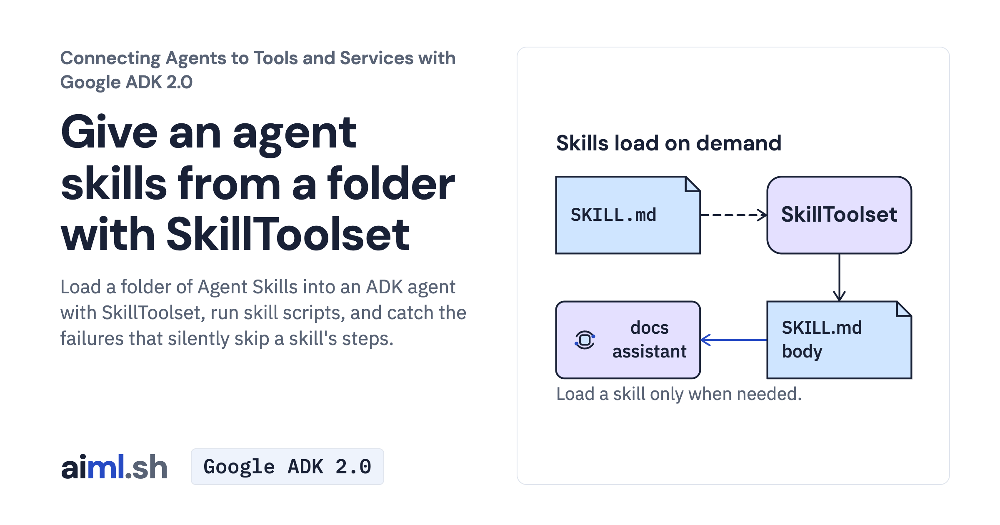

 [Connecting Agents to Tools and Services with Google ADK 2.0](../) · lesson 1 of 6

# Give an agent skills from a folder with SkillToolset

[](https://aiml.sh/courses/google-adk-integrations/give-an-agent-skills-from-a-folder/)

Load a folder of Agent Skills into an ADK agent with SkillToolset, run skill scripts, and catch the failures that silently skip a skill's steps.

- **Full lesson:** [https://aiml.sh/courses/google-adk-integrations/give-an-agent-skills-from-a-folder/](https://aiml.sh/courses/google-adk-integrations/give-an-agent-skills-from-a-folder/)
- **Reading time:** 20 min
- **Uses:** google-adk 2.12.0; litellm 1.102.4 for the Ollama alternative

## Lab

The [`lab/`](lab/) folder holds the complete runnable code, tests and recorded outputs, the same files as the lesson's download on aiml.sh. The lesson explains each step.

### Lab notes

#### Load procedures with SkillToolset

The docs assistant loads skills from `skills/`. The release-notes procedure fetches bundled pull-request fixtures, reads its style guide and runs `scripts/group_changes.py` through the configured local executor.

Use Python 3.12 or later. From this extracted lab directory:

```sh
python3.12 -m venv .venv
source .venv/bin/activate
python -m pip install -r requirements-lock.txt
```

Set `GOOGLE_API_KEY` in your terminal. Read `agent.py`, `skills/release-notes/SKILL.md` and the skill's script before running:

```sh
python agent.py "Write the release notes for docuctl 2.4.0."
python agent.py "Write the release notes for docuctl 9.9.0."
```

Each agent command invokes the model. The known version should follow the skill and call the script; the unknown version should report the fixture tool's error. A similar-looking answer without `run_skill_script` does not verify script execution. The local executor runs reviewed scripts with your process's permissions and inherited environment; it is not an isolation boundary.

For an already installed local model, set `DOCS_MODEL=ollama_chat/gemma4:e2b`. These commands do not install a model.

##### Offline tests

```sh
python -m unittest -v test_agent.py
```

The tests replay saved model responses through real skill loading, skill tools and the script executor. They make no new model requests. `record.py` is a separate live-recording utility and overwrites its result files.

##### Recorded execution evidence

The recorder made real Gemini API calls and used the local tools and services in this lab. The [provider attempt metadata and output hashes](lab/runs/docuctl-2026-10-25/provenance.json) identify the recorded output and captured attempts. Raw provider receipts remain private; the download excludes opaque model signatures and SQLite binaries. These records do not demonstrate browser interaction or reliability across other questions. Run the offline tests to exercise the selected replies without making paid model calls.
