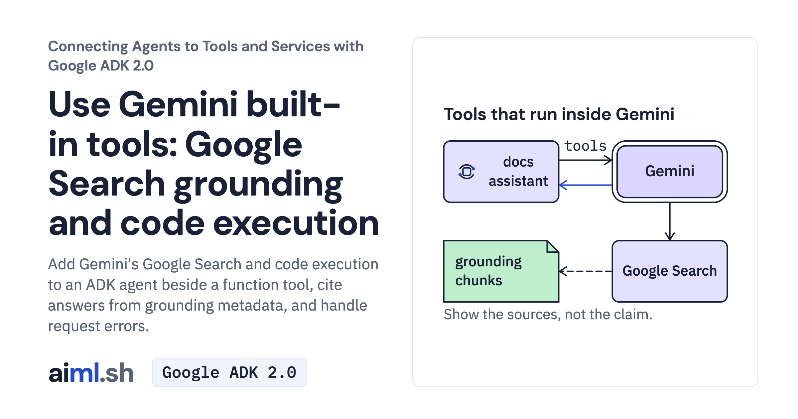

 [Connecting Agents to Tools and Services with Google ADK 2.0](../) · lesson 2 of 6

# Use Gemini built-in tools: Google Search grounding and code execution

[](https://aiml.sh/courses/google-adk-integrations/use-gemini-built-in-tools-google-search-and-code-execution/)

Add Gemini's Google Search and code execution to an ADK agent beside a function tool, cite answers from grounding metadata, and handle request errors.

- **Full lesson:** [https://aiml.sh/courses/google-adk-integrations/use-gemini-built-in-tools-google-search-and-code-execution/](https://aiml.sh/courses/google-adk-integrations/use-gemini-built-in-tools-google-search-and-code-execution/)
- **Reading time:** 20 min
- **Uses:** google-adk 2.12.0 with google-genai 2.32.0; litellm 1.102.4 only for the refused-model check

## Lab

The [`lab/`](lab/) folder holds the complete runnable code, tests and recorded outputs, the same files as the lesson's download on aiml.sh. The lesson explains each step.

### Lab notes

#### Google Search grounding and Gemini code execution

The assistant reads `docs/` with a local function tool, while Gemini runs Google Search and code execution on its servers. Inspect `agent.py` and its tool-combination flag before running.

Use Python 3.12 or later. From this extracted lab directory:

```sh
python3.12 -m venv .venv
source .venv/bin/activate
python -m pip install -r requirements-lock.txt
```

Set `GOOGLE_API_KEY` in this terminal, then ask:

```sh
python agent.py "Is the google-adk pin on the dependencies page current?"
python agent.py "Do the deploy timings meet the SLO?"
```

Each command makes fresh Gemini requests. Search output and package versions can change. Compare answer citations with grounding metadata, and compare computed statistics with the returned code and stdout. This lab has no local-model alternative because these built-ins run inside Gemini.

##### Offline tests

```sh
python -m unittest -v test_agent.py
```

Saved responses exercise real ADK request construction and event handling, including tool-combination refusal and a non-Gemini model. No new Search or code-execution service requests run in the tests. `record.py` is a live-recording utility, not an offline test.

The top-level agent limits each response to 2,048 output tokens and each question to six model calls. The bypass comparison creates a separate search agent; its captured request used an external operator cap of 8,192 output tokens. The recorded batch had a180-second deadline. These bounds limit the demonstration; they do not make search results authoritative.
