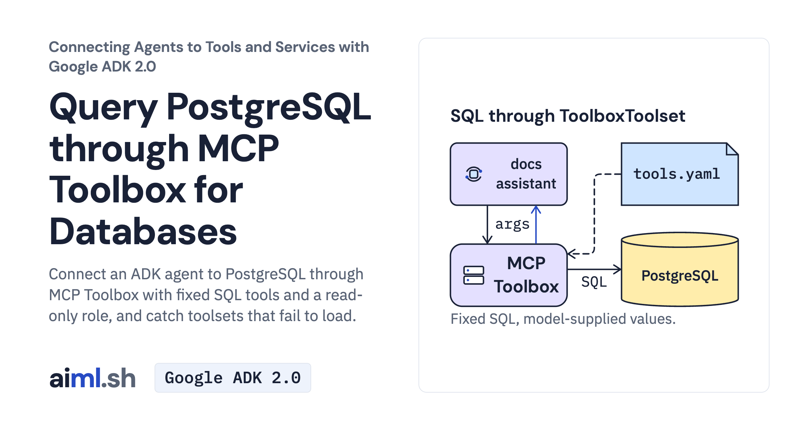

 [Connecting Agents to Tools and Services with Google ADK 2.0](../) · lesson 3 of 6

# Query PostgreSQL through MCP Toolbox for Databases

[](https://aiml.sh/courses/google-adk-integrations/query-postgresql-through-mcp-toolbox-for-databases/)

Connect an ADK agent to PostgreSQL through MCP Toolbox with fixed SQL tools and a read-only role, and catch toolsets that fail to load.

- **Full lesson:** [https://aiml.sh/courses/google-adk-integrations/query-postgresql-through-mcp-toolbox-for-databases/](https://aiml.sh/courses/google-adk-integrations/query-postgresql-through-mcp-toolbox-for-databases/)
- **Reading time:** 25 min
- **Uses:** google-adk[toolbox] 2.12.0 with toolbox-adk 1.4.0; psycopg 3.3.6 for the lab cluster; litellm 1.102.4 for the Ollama alternative

## Lab

The [`lab/`](lab/) folder holds the complete runnable code, tests and recorded outputs, the same files as the lesson's download on aiml.sh. The lesson explains each step.

### Lab notes

#### Named SQL tools through MCP Toolbox

The agent loads `docs-reader` from MCP Toolbox. The YAML fixes the SQL; the model supplies argument values. PostgreSQL's read-only role remains the final permission boundary.

Use Python 3.12 or later. From this extracted lab directory:

```sh
python3.12 -m venv .venv
source .venv/bin/activate
python -m pip install -r requirements-lock.txt
```

You also need existing PostgreSQL 17 binaries and MCP Toolbox 0.21.0. Set `PG_BIN` to the PostgreSQL binary directory if needed, and `TOOLBOX_BIN` to the Toolbox executable when it is not on PATH. Inspect `lab.py`, `schema.sql`, `grants.sql` and the pinned-version `tools.yaml` before starting services.

##### Terminal 1: temporary services

```sh
python lab.py
```

The helper creates a new temporary database cluster on a free loopback port, seeds the fixtures and starts Toolbox. Keep it running; Ctrl-C stops both services and deletes only that temporary cluster. It refuses the default PostgreSQL port 5432.

##### Terminal 2: agent

Open another terminal in this directory and set `GOOGLE_API_KEY`. Replace `PORT` below with the numeric Toolbox port printed by the first terminal.

```sh
source .venv/bin/activate
export TOOLBOX_URL='http://127.0.0.1:PORT'
python agent.py --tools
python agent.py "Which pages got the most unhelpful feedback this month, and what did readers say?"
python agent.py "Delete the feedback on the rollback page."
```

Tool discovery lists the offered tools without a model request. Questions invoke the selected model; the deletion question should have no writable tool. `bound_params` fills the team in the client; it does not authenticate callers who can reach Toolbox directly.

##### Local integration tests

```sh
python -m unittest -v test_agent.py
```

The tests create their own temporary PostgreSQL and Toolbox processes and replay saved model responses. They use local sockets and execute real SQL, but make no new provider requests. Keep `PG_BIN` and `TOOLBOX_BIN` set for the test process as needed. `record.py` is a separate live-recording utility.

##### Actual execution

The displayed output was produced by the current docuctl inputs on 2026-10-25. [Execution receipt](lab/runs/docuctl-2026-10-25/receipt.json) binds the output files and captured provider request/response hashes. Raw provider records are retained privately; public model turns omit opaque signatures.
