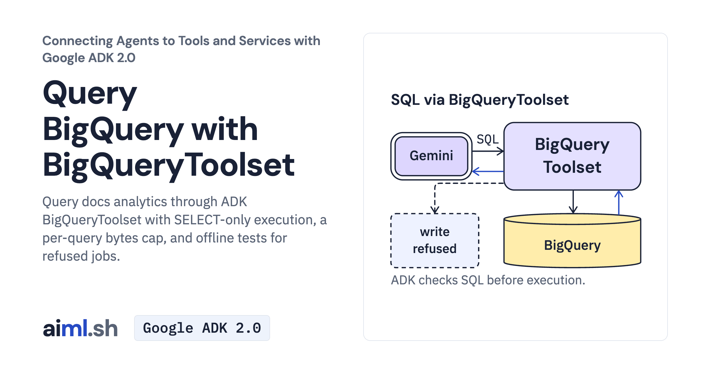

 [Connecting Agents to Tools and Services with Google ADK 2.0](../) · lesson 4 of 6

# Query BigQuery with BigQueryToolset

[](https://aiml.sh/courses/google-adk-integrations/query-bigquery-with-bigquerytoolset/)

Query docs analytics through ADK BigQueryToolset with SELECT-only execution, a per-query bytes cap, and offline tests for refused jobs.

- **Full lesson:** [https://aiml.sh/courses/google-adk-integrations/query-bigquery-with-bigquerytoolset/](https://aiml.sh/courses/google-adk-integrations/query-bigquery-with-bigquerytoolset/)
- **Reading time:** 25 min
- **Uses:** google-adk[gcp] 2.12.0 with google-cloud-bigquery 3.46.2

## Lab

The [`lab/`](lab/) folder holds the complete runnable code, tests and recorded outputs, the same files as the lesson's download on aiml.sh. The lesson explains each step.

### Lab notes

#### Query docs analytics through ADK BigQueryToolset

The agent offers three BigQuery tools, rejects non-SELECT statements in the client and sets a 10 MiB maximum bytes billed per query job. These controls do not restrict every readable table or cap total project and model costs.

##### Run

Use Python 3.12+, Application Default Credentials and an explicitly chosen project. Set GOOGLE_API_KEY for the Gemini API. Dataset, query and model usage may incur charges.

```sh
python3.12 -m venv .venv
source .venv/bin/activate
pip install -r requirements-lock.txt
gcloud auth application-default login
export GOOGLE_CLOUD_PROJECT=your-project-id
./setup.sh
python agent.py --tools
python agent.py "Which docs pages had the most views in the week of October 12?"
```

Setup creates the named lesson dataset and two tables; cleanup deletes that dataset. record.py makes model calls and reads labelled job counters.

##### Offline tests

```sh
python -m unittest -v test_agent.py
```

Tests replay saved model turns through the installed ADK tools with a stub BigQuery client. They check query settings, refused writes and project mismatch. The bytes-limit test inspects a previously recorded job; it runs no new billed query. Job counters are not an invoice.

##### Cleanup

Inspect `cleanup.sh` and confirm that the selected project and `aiml_docs_analytics` dataset are the lesson resources you intend to remove.

```sh
./cleanup.sh
```

##### Actual execution

The displayed output was produced by the current docuctl inputs on 2026-10-25. [Execution receipt](lab/runs/docuctl-2026-10-25/receipt.json) binds the output files and captured provider request/response hashes. Raw provider records are retained privately; public model turns omit opaque signatures.
