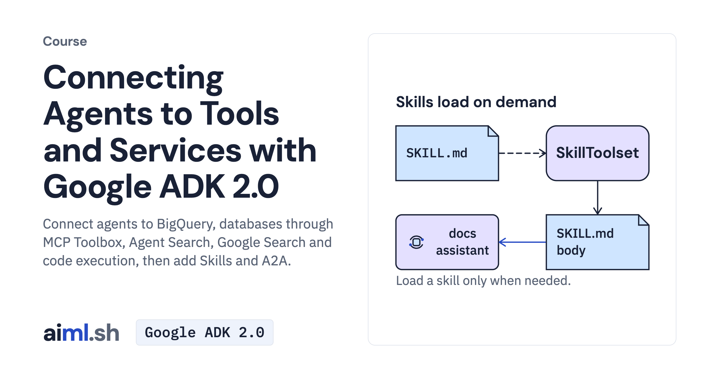

#  Connecting Agents to Tools and Services with Google ADK 2.0

Connect agents to BigQuery, databases through MCP Toolbox, Agent Search, Google Search and code execution, then add Skills and A2A.

- **Course on aiml.sh:** [https://aiml.sh/courses/google-adk-integrations/](https://aiml.sh/courses/google-adk-integrations/)
- **Lessons:** 6 · **Reading time:** about 2 hours
- **Prerequisites:** Python, HTTP APIs, and ADK agents with tools (the Building Agents with Google ADK 2.0 course covers them).
- **Framework:** Google ADK 2.0

## What you'll learn

- Load Agent Skills from a folder and run their scripts through a code executor.
- Ground answers with Google Search and compute with Gemini code execution, and cite from grounding metadata.
- Query PostgreSQL through MCP Toolbox for Databases with fixed SQL tools and a read-only role.
- Serve an agent over A2A and call it from another agent.

## Lessons

| # | Lesson | Time | Code | Full lesson |
|---|---|---|---|---|
| 1 | [Give an agent skills from a folder with SkillToolset](01-give-an-agent-skills-from-a-folder/) | 20&nbsp;min | [lab](01-give-an-agent-skills-from-a-folder/lab/) | [read](https://aiml.sh/courses/google-adk-integrations/give-an-agent-skills-from-a-folder/) |
| 2 | [Use Gemini built-in tools: Google Search grounding and code execution](02-use-gemini-built-in-tools-google-search-and-code-execution/) | 20&nbsp;min | [lab](02-use-gemini-built-in-tools-google-search-and-code-execution/lab/) | [read](https://aiml.sh/courses/google-adk-integrations/use-gemini-built-in-tools-google-search-and-code-execution/) |
| 3 | [Query PostgreSQL through MCP Toolbox for Databases](03-query-postgresql-through-mcp-toolbox-for-databases/) | 25&nbsp;min | [lab](03-query-postgresql-through-mcp-toolbox-for-databases/lab/) | [read](https://aiml.sh/courses/google-adk-integrations/query-postgresql-through-mcp-toolbox-for-databases/) |
| 4 | [Query BigQuery with BigQueryToolset](04-query-bigquery-with-bigquerytoolset/) | 25&nbsp;min | [lab](04-query-bigquery-with-bigquerytoolset/lab/) | [read](https://aiml.sh/courses/google-adk-integrations/query-bigquery-with-bigquerytoolset/) |
| 5 | [Search private data stores with Agent Search](05-search-private-data-stores-with-agent-search/) | 25&nbsp;min | [lab](05-search-private-data-stores-with-agent-search/lab/) | [read](https://aiml.sh/courses/google-adk-integrations/search-private-data-stores-with-agent-search/) |
| 6 | [Expose the docs assistant over A2A and consume it](06-expose-an-agent-over-a2a-and-consume-it/) | 25&nbsp;min | [lab](06-expose-an-agent-over-a2a-and-consume-it/lab/) | [read](https://aiml.sh/courses/google-adk-integrations/expose-an-agent-over-a2a-and-consume-it/) |

Each lesson folder has a short summary, its diagram and its lab. The complete lesson, with explanations, recorded results and checks, is on aiml.sh.

[Back to all courses](../../README.md#courses)
