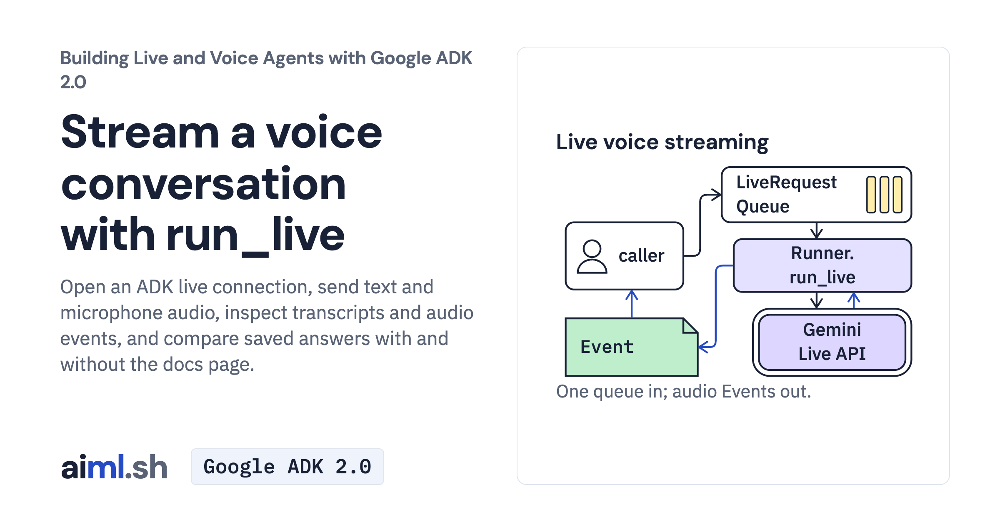

 [Building Live and Voice Agents with Google ADK 2.0](../) · lesson 1 of 7

# Stream a voice conversation with run_live

Open an ADK live connection, send text and microphone audio, inspect transcripts and audio events, and compare saved answers with and without the docs page.

- **Full lesson:** [https://aiml.sh/courses/google-adk-live/stream-a-voice-conversation-with-run-live/](https://aiml.sh/courses/google-adk-live/stream-a-voice-conversation-with-run-live/)
- **Reading time:** 25 min
- **Uses:** google-adk 2.12.0

## Lab

The [`lab/`](lab/) folder holds the complete runnable code, tests and recorded outputs, the same files as the lesson's download on aiml.sh. The lesson explains each step.
