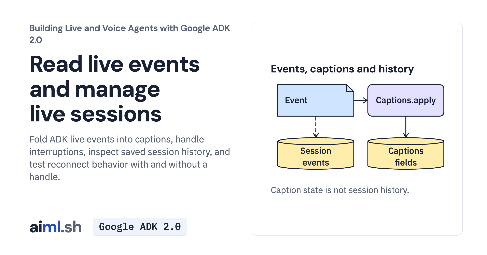

 [Building Live and Voice Agents with Google ADK 2.0](../) · lesson 2 of 7

# Read live events and manage live sessions

Fold ADK live events into captions, handle interruptions, inspect saved session history, and test reconnect behavior with and without a handle.

- **Full lesson:** [https://aiml.sh/courses/google-adk-live/read-live-events-and-manage-live-sessions/](https://aiml.sh/courses/google-adk-live/read-live-events-and-manage-live-sessions/)
- **Reading time:** 30 min
- **Uses:** google-adk 2.12.0

## Lab

The [`lab/`](lab/) folder holds the complete runnable code, tests and recorded outputs, the same files as the lesson's download on aiml.sh. The lesson explains each step.
