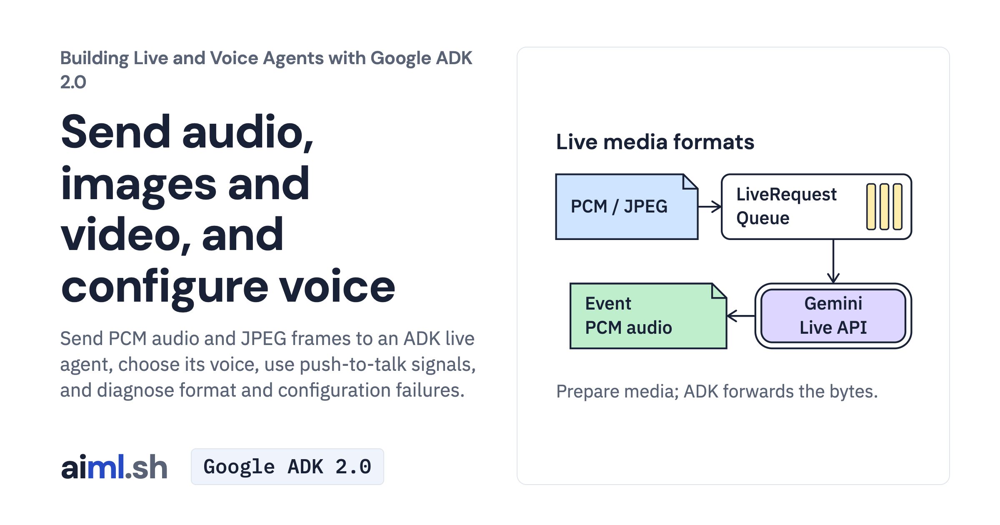

 [Building Live and Voice Agents with Google ADK 2.0](../) · lesson 3 of 7

# Send audio, images and video, and configure voice

Send PCM audio and JPEG frames to an ADK live agent, choose its voice, use push-to-talk signals, and diagnose format and configuration failures.

- **Full lesson:** [https://aiml.sh/courses/google-adk-live/send-audio-images-and-video-and-configure-voice/](https://aiml.sh/courses/google-adk-live/send-audio-images-and-video-and-configure-voice/)
- **Reading time:** 25 min
- **Uses:** google-adk 2.12.0

## Lab

The [`lab/`](lab/) folder holds the complete runnable code, tests and recorded outputs, the same files as the lesson's download on aiml.sh. The lesson explains each step.
