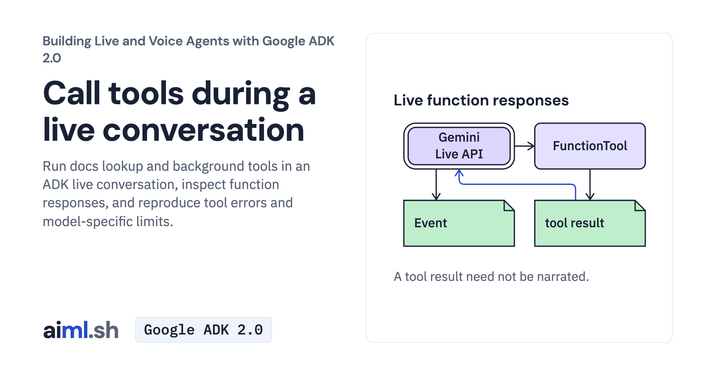

 [Building Live and Voice Agents with Google ADK 2.0](../) · lesson 4 of 7

# Call tools during a live conversation

Run docs lookup and background tools in an ADK live conversation, inspect function responses, and reproduce tool errors and model-specific limits.

- **Full lesson:** [https://aiml.sh/courses/google-adk-live/call-tools-during-a-live-conversation/](https://aiml.sh/courses/google-adk-live/call-tools-during-a-live-conversation/)
- **Reading time:** 30 min
- **Uses:** google-adk 2.12.0

## Lab

The [`lab/`](lab/) folder holds the complete runnable code, tests and recorded outputs, the same files as the lesson's download on aiml.sh. The lesson explains each step.
