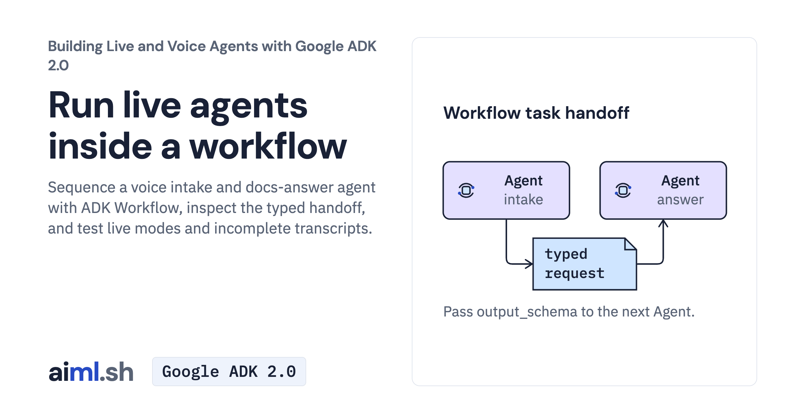

 [Building Live and Voice Agents with Google ADK 2.0](../) · lesson 5 of 7

# Run live agents inside a workflow

Sequence a voice intake and docs-answer agent with ADK Workflow, inspect the typed handoff, and test live modes and incomplete transcripts.

- **Full lesson:** [https://aiml.sh/courses/google-adk-live/run-live-agents-inside-a-workflow/](https://aiml.sh/courses/google-adk-live/run-live-agents-inside-a-workflow/)
- **Reading time:** 25 min
- **Uses:** google-adk 2.12.0

## Lab

The [`lab/`](lab/) folder holds the complete runnable code, tests and recorded outputs, the same files as the lesson's download on aiml.sh. The lesson explains each step.
