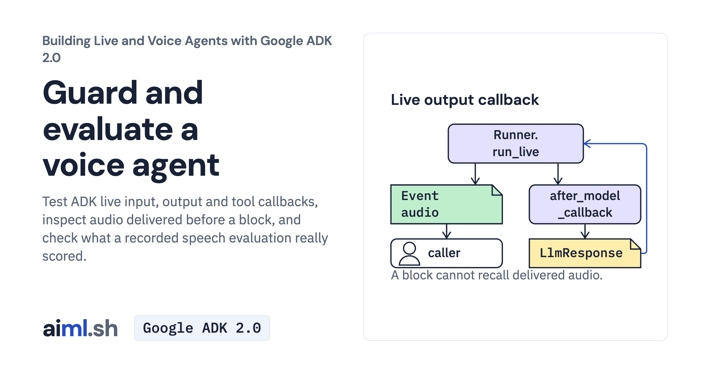

 [Building Live and Voice Agents with Google ADK 2.0](../) · lesson 6 of 7

# Guard and evaluate a voice agent

Test ADK live input, output and tool callbacks, inspect audio delivered before a block, and check what a recorded speech evaluation really scored.

- **Full lesson:** [https://aiml.sh/courses/google-adk-live/guard-and-evaluate-a-voice-agent/](https://aiml.sh/courses/google-adk-live/guard-and-evaluate-a-voice-agent/)
- **Reading time:** 25 min
- **Uses:** google-adk 2.12.0

## Lab

The [`lab/`](lab/) folder holds the complete runnable code, tests and recorded outputs, the same files as the lesson's download on aiml.sh. The lesson explains each step.
