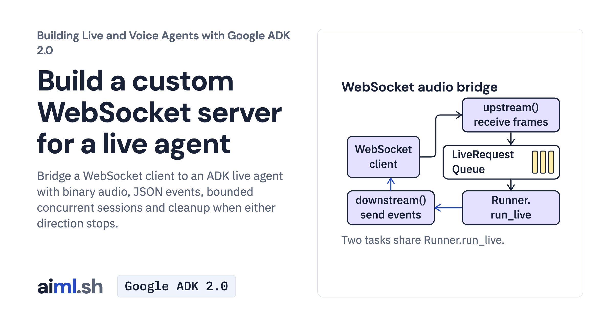

 [Building Live and Voice Agents with Google ADK 2.0](../) · lesson 7 of 7

# Build a custom WebSocket server for a live agent

Bridge a WebSocket client to an ADK live agent with binary audio, JSON events, bounded concurrent sessions and cleanup when either direction stops.

- **Full lesson:** [https://aiml.sh/courses/google-adk-live/build-a-custom-websocket-server-for-a-live-agent/](https://aiml.sh/courses/google-adk-live/build-a-custom-websocket-server-for-a-live-agent/)
- **Reading time:** 25 min
- **Uses:** google-adk 2.12.0

## Lab

The [`lab/`](lab/) folder holds the complete runnable code, tests and recorded outputs, the same files as the lesson's download on aiml.sh. The lesson explains each step.
