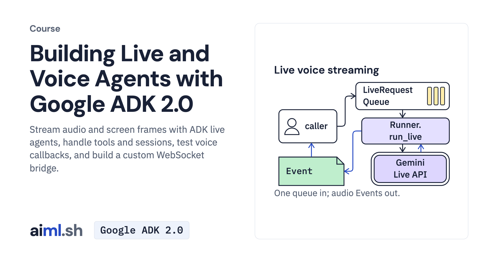

#  Building Live and Voice Agents with Google ADK 2.0

Stream audio and screen frames with ADK live agents, handle tools and sessions, test voice callbacks, and build a custom WebSocket bridge.

- **Course on aiml.sh:** [https://aiml.sh/courses/google-adk-live/](https://aiml.sh/courses/google-adk-live/)
- **Lessons:** 7 · **Reading time:** about 3 hours
- **Prerequisites:** Python async code and the Building Agents with Google ADK 2.0 course or equivalent ADK experience. Live runs need a Gemini Live API key; recorded replays do not.
- **Framework:** Google ADK 2.0

## What you'll learn

- Stream audio, transcriptions and control events through run_live.
- Manage live sessions, media formats and tool responses.
- Sequence live task nodes and inspect typed handoffs.
- Test callback limits and clean up custom WebSocket connections.

## Lessons

| # | Lesson | Time | Code | Full lesson |
|---|---|---|---|---|
| 1 | [Stream a voice conversation with run_live](01-stream-a-voice-conversation-with-run-live/) | 25&nbsp;min | [lab](01-stream-a-voice-conversation-with-run-live/lab/) | [read](https://aiml.sh/courses/google-adk-live/stream-a-voice-conversation-with-run-live/) |
| 2 | [Read live events and manage live sessions](02-read-live-events-and-manage-live-sessions/) | 30&nbsp;min | [lab](02-read-live-events-and-manage-live-sessions/lab/) | [read](https://aiml.sh/courses/google-adk-live/read-live-events-and-manage-live-sessions/) |
| 3 | [Send audio, images and video, and configure voice](03-send-audio-images-and-video-and-configure-voice/) | 25&nbsp;min | [lab](03-send-audio-images-and-video-and-configure-voice/lab/) | [read](https://aiml.sh/courses/google-adk-live/send-audio-images-and-video-and-configure-voice/) |
| 4 | [Call tools during a live conversation](04-call-tools-during-a-live-conversation/) | 30&nbsp;min | [lab](04-call-tools-during-a-live-conversation/lab/) | [read](https://aiml.sh/courses/google-adk-live/call-tools-during-a-live-conversation/) |
| 5 | [Run live agents inside a workflow](05-run-live-agents-inside-a-workflow/) | 25&nbsp;min | [lab](05-run-live-agents-inside-a-workflow/lab/) | [read](https://aiml.sh/courses/google-adk-live/run-live-agents-inside-a-workflow/) |
| 6 | [Guard and evaluate a voice agent](06-guard-and-evaluate-a-voice-agent/) | 25&nbsp;min | [lab](06-guard-and-evaluate-a-voice-agent/lab/) | [read](https://aiml.sh/courses/google-adk-live/guard-and-evaluate-a-voice-agent/) |
| 7 | [Build a custom WebSocket server for a live agent](07-build-a-custom-websocket-server-for-a-live-agent/) | 25&nbsp;min | [lab](07-build-a-custom-websocket-server-for-a-live-agent/lab/) | [read](https://aiml.sh/courses/google-adk-live/build-a-custom-websocket-server-for-a-live-agent/) |

Each lesson folder has a short summary, its diagram and its lab. The complete lesson, with explanations, recorded results and checks, is on aiml.sh.

[Back to all courses](../../README.md#courses)
