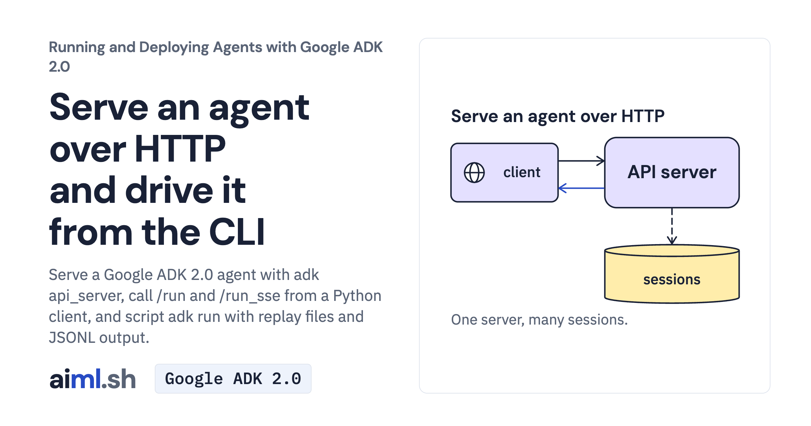

 [Running and Deploying Agents with Google ADK 2.0](../) · lesson 1 of 20

# Serve an agent over HTTP and drive it from the CLI

[](https://aiml.sh/courses/google-adk-production/serve-an-agent-over-http-and-drive-it-from-the-cli/)

Serve a Google ADK 2.0 agent with adk api_server, call /run and /run_sse from a Python client, and script adk run with replay files and JSONL output.

- **Full lesson:** [https://aiml.sh/courses/google-adk-production/serve-an-agent-over-http-and-drive-it-from-the-cli/](https://aiml.sh/courses/google-adk-production/serve-an-agent-over-http-and-drive-it-from-the-cli/)
- **Reading time:** 20 min
- **Uses:** google-adk, httpx and FastAPI; litellm for an existing Ollama model

## Lab

The [`lab/`](lab/) folder holds the complete runnable code, tests and recorded outputs, the same files as the lesson's download on aiml.sh. The lesson explains each step.

### Lab notes

#### Serve an agent over HTTP

This project contains the actual `docs_assistant` ADK package, docs, HTTP client, locked dependencies and offline tests. Use the project root as the working directory.

```sh
python3.12 -m venv .venv
source .venv/bin/activate
python -m pip install -r requirements-lock.txt
cp docs_assistant/.env.example docs_assistant/.env
```

Fill `GOOGLE_API_KEY` in `docs_assistant/.env`; never commit it. The native server loads that agent configuration. The alternative `DOCS_MODEL=ollama_chat/gemma4:e2b` requires an existing local model.

Terminal 1:

```sh
adk api_server --host 127.0.0.1 --port 8765 \
  --session_service_uri sqlite:///sessions.db \
  --allow_origins http://localhost:3000 .
```

Terminal 2, from this same directory with the environment activated:

```sh
python client.py "How do I undo the last production deploy?"
python client.py --stream "Which page explains tokens?"
```

Each client command calls the configured model. To inspect the same agent in the development Web UI, stop the API server, run the command below, select `docs_assistant`, then send one question and inspect its events.

```sh
adk web --host 127.0.0.1 --port 8765 \
  --session_service_uri sqlite:///sessions.db .
```

Offline tests:

```sh
python -m unittest -v test_server.py test_recording_opt_in.py
```

`python record.py --record` is an optional multi-call recorder that overwrites historical run files. Do not use it as a startup check. Startup/session checks do not establish a generated answer.

Current references: https://adk.dev/runtime/api-server/ and https://adk.dev/runtime/web-interface/. ADK Web is for development only. Stop your server with Ctrl-C. Session data remains in `sessions.db` until you remove it.

##### Recorded execution evidence

The recorder made real Gemini API calls and used the local tools and services in this lab. The [provider attempt metadata and output hashes](lab/runs/docuctl-2026-10-25/provenance.json) identify the recorded output and captured attempts. Raw provider receipts remain private; the download excludes opaque model signatures and SQLite binaries. These records do not demonstrate browser interaction or reliability across other questions. Run the offline tests to exercise the selected replies without making paid model calls.
