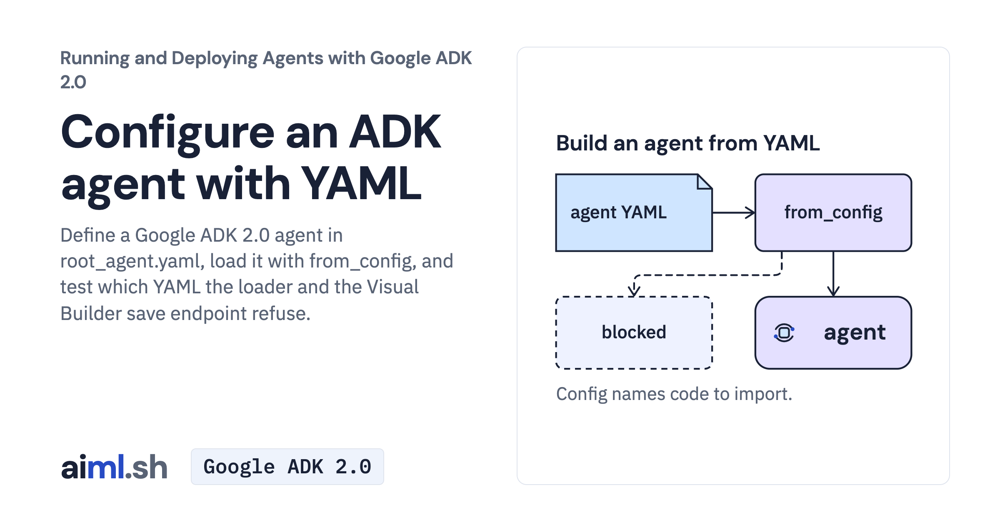

 [Running and Deploying Agents with Google ADK 2.0](../) · lesson 2 of 20

# Configure an ADK agent with YAML

[](https://aiml.sh/courses/google-adk-production/build-an-agent-as-yaml-config-and-in-visual-builder/)

Define a Google ADK 2.0 agent in root_agent.yaml, load it with from_config, and test which YAML the loader and the Visual Builder save endpoint refuse.

- **Full lesson:** [https://aiml.sh/courses/google-adk-production/build-an-agent-as-yaml-config-and-in-visual-builder/](https://aiml.sh/courses/google-adk-production/build-an-agent-as-yaml-config-and-in-visual-builder/)
- **Reading time:** 20 min
- **Uses:** google-adk 2.12.0

## Lab

The [`lab/`](lab/) folder holds the complete runnable code, tests and recorded outputs, the same files as the lesson's download on aiml.sh. The lesson explains each step.

### Lab notes

#### Configure an ADK Agent with YAML

Run from this directory after installing `requirements-lock.txt` in your environment. Provider-backed commands require `GOOGLE_API_KEY` in the shell and incur model usage. The local environment must match the pinned dependencies; no install is performed by the example.

From the extracted lab directory (the parent of `docs_config/`), set `GOOGLE_API_KEY` in your shell and start the native ADK CLI. Enter `Which page explains CI tokens?` at its prompt. This sends a new model request; the saved output is a previous run.

```sh
adk run docs_config
```

For the Dev UI, stop the CLI and run the next command from the same directory. Open the printed loopback URL, select **docs_config**, and ask the same question. In Visual Builder, inspect the instruction and tool reference before saving; saving changes the YAML on disk. The saved evidence exercises builder HTTP endpoints; it is not a recording of these browser actions.

```sh
adk web --host 127.0.0.1 --port 8766 .
```

##### Offline checks and saved evidence

```sh
python -m unittest -v test_config.py
```

These tests use controlled or recorded model responses; passing them is not a fresh model outcome. The saved model responses are from the docuctl experiment. `record.py` is a fresh experiment recorder, not an offline replay command; it may make provider calls and replace saved results. Do not run it to view existing evidence.

##### Recorded execution evidence

The recorder made real Gemini API calls and used the local tools and services in this lab. The [provider attempt metadata and output hashes](lab/runs/docuctl-2026-10-25/provenance.json) identify the recorded output and captured attempts. Raw provider receipts remain private; the download excludes opaque model signatures and SQLite binaries. These records do not demonstrate browser interaction or reliability across other questions. Run the offline tests to exercise the selected replies without making paid model calls.
