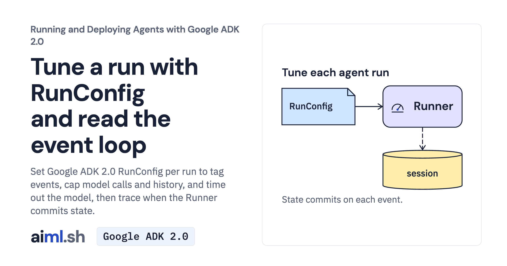

 [Running and Deploying Agents with Google ADK 2.0](../) · lesson 3 of 20

# Tune a run with RunConfig and read the event loop

[](https://aiml.sh/courses/google-adk-production/tune-a-run-with-runconfig-and-read-the-event-loop/)

Set Google ADK 2.0 RunConfig per run to tag events, cap model calls and history, and time out the model, then trace when the Runner commits state.

- **Full lesson:** [https://aiml.sh/courses/google-adk-production/tune-a-run-with-runconfig-and-read-the-event-loop/](https://aiml.sh/courses/google-adk-production/tune-a-run-with-runconfig-and-read-the-event-loop/)
- **Reading time:** 20 min
- **Uses:** google-adk 2.12.0; litellm 1.102.4 for the Ollama alternative

## Lab

The [`lab/`](lab/) folder holds the complete runnable code, tests and recorded outputs, the same files as the lesson's download on aiml.sh. The lesson explains each step.

### Lab notes

#### Tune a run with RunConfig and read the event loop

Run from this directory after installing `requirements-lock.txt` in your environment. Provider-backed commands require `GOOGLE_API_KEY` in the shell and incur model usage. The local environment must match the pinned dependencies; no install is performed by the example.

From the extracted lab directory, with `GOOGLE_API_KEY` available in your shell, run the three-turn experiment:

```sh
python tune.py
```

This makes fresh model requests. Compare each `req-1`, `req-2` and `req-3` section with its `model`, `tool` and `event` lines. The third turn supplies `num_recent_events=4`. A plain `adk run tune` or `adk web` launch would not reproduce this experiment: the Python caller creates the session service and passes a distinct `RunConfig` to each `runner.run_async` call. Use the offline test command below to replay saved model replies without a provider call.

##### Offline checks and saved evidence

```sh
python -m unittest -v test_tune.py
```

These tests use controlled or recorded model responses; passing them is not a fresh model outcome. The saved model responses are from the docuctl experiment. `record.py` is a fresh experiment recorder, not an offline replay command; it may make provider calls and replace saved results. Do not run it to view existing evidence.

##### Recorded execution evidence

The recorder made real Gemini API calls and used the local tools and services in this lab. The [provider attempt metadata and output hashes](lab/runs/docuctl-2026-10-25/provenance.json) identify the recorded output and captured attempts. Raw provider receipts remain private; the download excludes opaque model signatures and SQLite binaries. These records do not demonstrate browser interaction or reliability across other questions. Run the offline tests to exercise the selected replies without making paid model calls.
